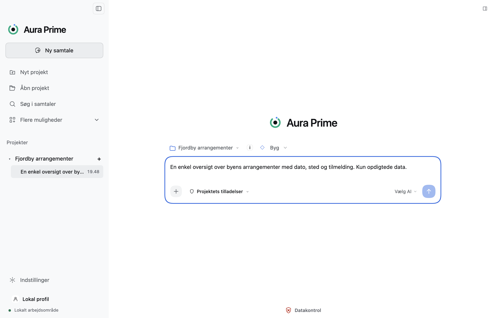
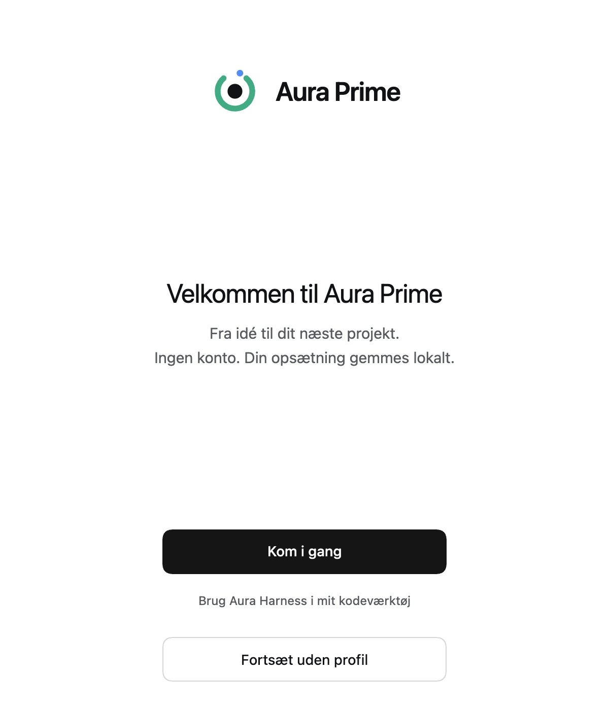
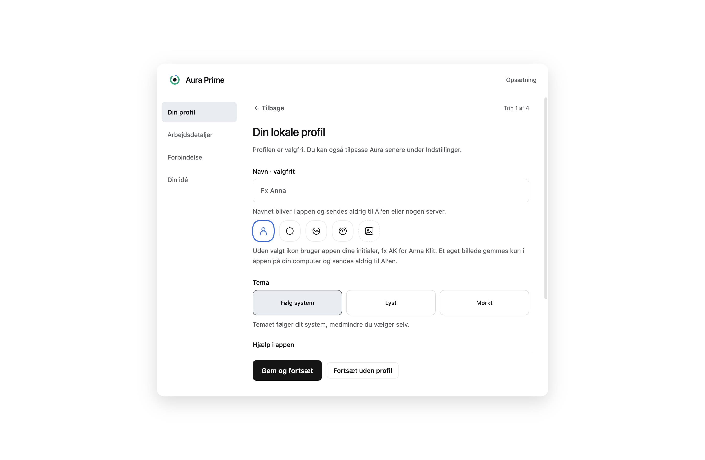
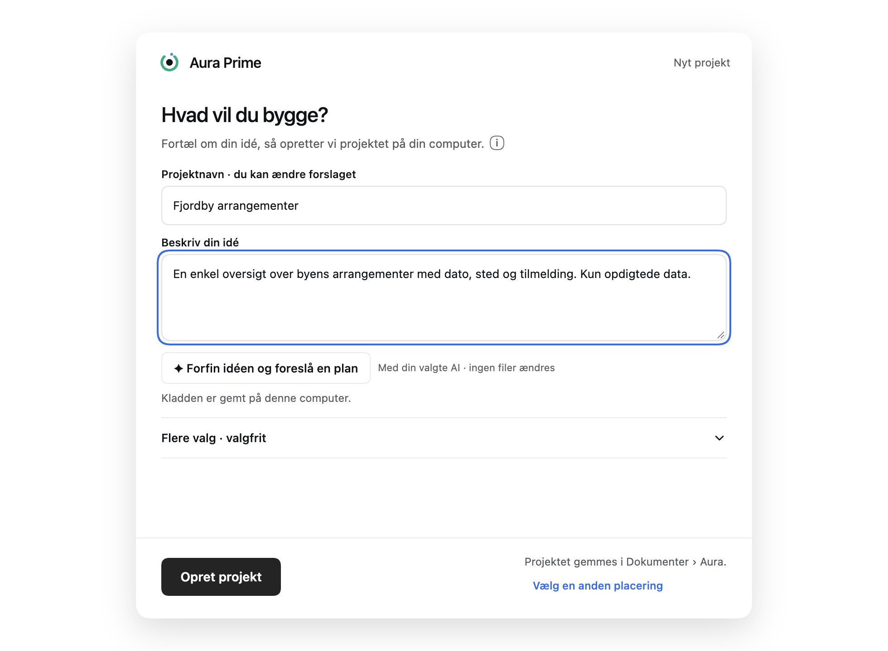
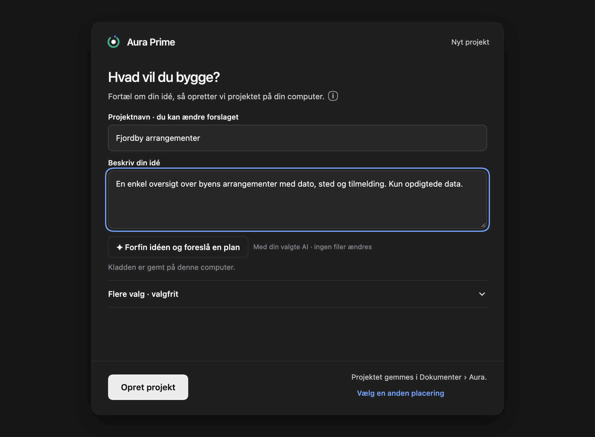
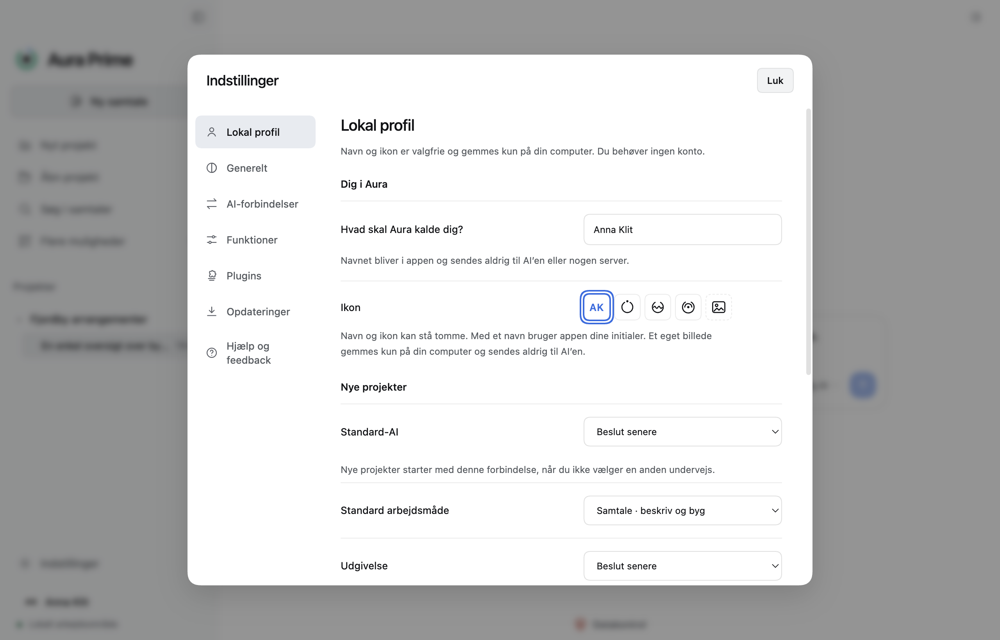
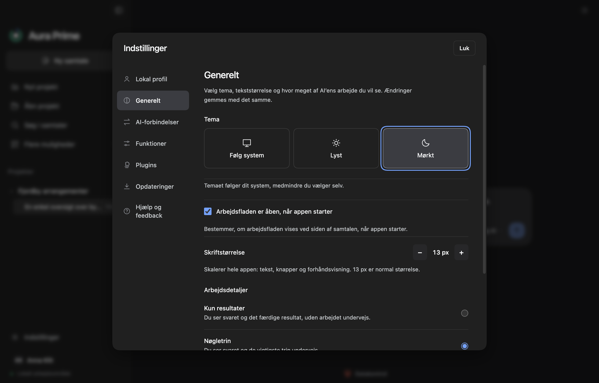
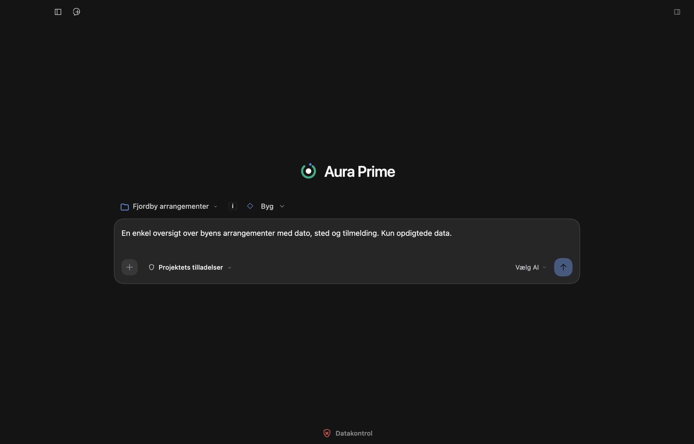

# Aura Prime

Aura Prime hjælper dig fra idé til plan, kode og forhåndsvisning i et lokalt arbejdsområde. Appen bygger videre på [Aura Harness fra AI Alliancen](https://github.com/ai-alliancen-org/ai-harness) med OpenCode som kodeagent og frit valg af AI-forbindelse.

**Aktuel kildeversion: `0.6.0-beta.6`, 5. november 2026.** Alle billeder nedenfor er fra den færdige beta 6 på macOS med isolerede testprofiler og det opdigtede projekt *Fjordby arrangementer*. Versionen er en udviklingsbeta til macOS på Apple Silicon: [Hent **Aura Prime 0.6.0 beta 6**](https://github.com/Parthee-Vijaya/Aura-Prime/releases/tag/v0.6.0-beta.6) (ad hoc-signeret, ikke notariseret). [Noter og kontrolsummer](docs/releases/aura-prime-0.6.0-beta.6.md).



## Det nye arbejdsområde

Det fulde redesign giver en roligere arbejdsapp med et nyt opstartsforløb. Aura beholder sit eget navn, logo og sine eksisterende funktioner.

- **Ingen konto eller login til Aura.** Start direkte, eller opret en valgfri lokal profil. Navn og ikon kan stå tomme. Profil og indstillinger gemmes på computeren.
- **En rolig start.** Et kompakt velkomstvindue åbner projektopsætningen. Arbejdsdetaljer, AI-forbindelser og idéhjælp er stadig tilgængelige gennem onboarding.
- **Et integreret logo.** Aura-identiteten indgår i velkomst, sidebar og den centrerede samtalestart.
- **En sidebar, der kan skjules helt.** Åbn den igen fra arbejdsområdets top. Projekter, samtaler, søgning og indstillinger er samlet til venstre.
- **Flere AI-udbydere og plugins.** Under AI-forbindelser ligger de kendte udbydere som kort, og nye som Google Gemini, Groq, xAI og LM Studio i en dropdown. Under Plugins styrer du webhentning og kontekstvisning. Plugins, der endnu ikke kan dækkes sikkert, står med en begrundelse.
- **Samlede indstillinger.** Lokal profil, generelle valg, AI-forbindelser, funktioner, opdateringer og hjælp har samme navigation. Vælg lyst, mørkt eller systemets tema, og justér tekststørrelsen.
- **Adgang til arbejdsdetaljer.** Samtalen og arbejdssporet supplerer forhåndsvisning, plan, ændringer, kode og aktivitet. Det midlertidigt lukkede panel i en ny samtale overskriver ikke dit gemte layoutvalg.

### Fra første åbning til projekt



Vælg **Kom i gang** for det guidede forløb eller **Fortsæt uden profil** for at gå direkte til projektidéen. En AI-forbindelse kan tilføjes senere. Den lokale profil kræver ingen registrering.





**Nyt projekt kræver ingen scrolling i standardvisningen ved 980 × 720 og normal tekststørrelse.** Navn, idé, tilvalg, placering og Opret er synlige. Åbnede tilvalg og længere indhold kan rulle, mens opret-handlingen bliver stående.

Idéen gemmes som lokal kladde. Oprettelse af et projekt kontakter ikke i sig selv en AI. Vælg din forbindelse, gennemgå den konkrete afsendelse, og fortsæt med den ønskede arbejdsmåde.

### Palette, indstillinger og sidepanel

Paletten er neutral med en blå accentfarve. Lyst tema har hvide felter og næsten hvid sidebar. Mørkt tema har et mørkt lærred og lidt lysere felter. Auras eget navn og logo bevares.



Profilen er fortsat valgfri og lokal. Tema, skriftstørrelse og arbejdsdetaljer ændres i de samlede indstillinger. Sidepanelet kan skjules helt og åbnes igen fra arbejdsområdets top.







Billederne er direkte optagelser af den pakkede Electron-app med syntetiske data og ingen modelbesvarelser. [Alle 11 optagelser og målinger](docs/releases/beta6-evidence/qualification.json) omfatter også den lyse skjulte sidebar og den mørke arbejdsflade.

## Funktionerne følger med

Arbejd videre med **Samtale, Planlæg og Byg**, lokale projekter, historik, kladder, modelvalg, forbrug og kontekst. Vedhæft tekstfiler, billeder og PDF, eller vælg en referencemappe med læseadgang. Gennemgå planer, filændringer og værktøjshandlinger, og afprøv understøttede webprojekter i forhåndsvisningen.

Redesignet bevarer datagennemgang, Privacy Gate, godkendelser, Stop/genoptagelse og lokale Git-versioner. YOLO under Byg kræver fortsat advarsel og bekræftelse, gælder kun den aktuelle samtale og ophæver ikke beskyttede filer eller datadelingsgrænser.

Stop afslutter også løsrevne underprocesser pr. kommando på macOS. Linux og Windows har endnu ikke denne kvalificerede kommandokørsel. Terminalgrænser, websøgning og MCP er fortsat utilgængelige; blandt andet mangler et samlet output- og outputfil-loft. De nye udbydere er ikke alle afprøvet med rigtige nøgler. [Betaens kvalifikation og begrænsninger](docs/releases/aura-prime-0.6.0-beta.6.md).

- [Privacy Gate og isolation](docs/privacy-gate.md)
- [YOLO og samtaletilladelser](docs/yolo.md)
- [Designhjælp til dine egne apps](docs/aura-design-skill.md)
- [Lokal kontrol af genererede webapps](docs/design-quality-control.md)
- [OpenCode 2 og samtalemigration](docs/opencode-2-upgrade.md)

Lokale projektfiler og en lokal profil betyder ikke, at alle AI-kald behandles lokalt. Den valgte modeludbyder kan modtage det indhold, du godkender at sende. Adgang og betaling til eksterne tjenester håndteres særskilt.

## Start fra kildekoden

Kræver Git, npm og Node.js 22.12 eller nyere. Brug den låste Node 22-runtime til projektets byte-reproducerbare pakkekontrol.

```bash
git clone --branch work/aura-prime-uiux-20261102 https://github.com/Parthee-Vijaya/Aura-Prime.git
cd Aura-Prime/desktop
npm ci
npm run runtime:prepare
npm start
```

Vælg derefter en AI-forbindelse i appen, eller fortsæt uden AI for at se dig omkring. API-nøgler indtastes gennem **Indtast nøgle sikkert** i et separat vindue. Se [desktopvejledningen](desktop/README.md) og [nøgleindtastningens afgrænsning](docs/contributions/f05.md).

Fra repositoryets rod kan den samlede lokale kontrol køres med:

```bash
npm run check
```

[Kontrollen af projektlayout og farver](docs/design/project-layout-20261104.md) beskriver de gennemgåede skærme, centreringsrettelsen og afprøvningens grænser. [Designkontrakten](desktop/DESIGN.md) og [den native reference](docs/design/native-reference-20261104.md) beskriver retningen.

## Aura Harness i terminalen og dit eget kodeværktøj

[CLI-vejledningen](cli/README.md) beskriver kodeagent, godkendelser, modelforbindelser og lokale projekter i terminalen. Se også [macOS](cli/MACOS.md), [Windows](cli/WINDOWS.md) og [Linux](cli/LINUX.md).

Grundregler og skills kan bruges i blandt andet Codex, Claude Code, OpenCode, Cursor og GitHub Copilot. Fra repositoryets rod:

```bash
node scripts/harness.cjs install --tools codex --project ../mit-projekt
```

Appen har også indgangen **Brug Aura Harness i mit kodeværktøj**. Den viser ændringerne før installation. Egne regler bevares, og lokalt ændrede filer springes over ved opdatering. Se [skillkataloget](profiles/SKILLS.md).

## Dokumentation og bidrag

| Mappe | Indhold |
| --- | --- |
| `desktop/` | Electron-app, agentadapter, design og lokale tests |
| `cli/` | Terminalklient og platformsvejledninger |
| `profiles/` | Grundregler og skills |
| `docs/` | Funktioner, design, kontrolgrundlag og historiske udgivelser |
| `site/` | Webguide og instruktionspakker |

[Opret en issue](https://github.com/Parthee-Vijaya/Aura-Prime/issues) med forventet og faktisk adfærd. Se [bidragsvejledningen](CONTRIBUTING.md), [sikkerhedspolitikken](SECURITY.md) og [versionspolitikken](docs/releases/POLICY.md). Ældre billeder og testtal i versionsnoter beskriver den pågældende historiske udgave.

Aura Prime er Parthee-Vijayas fork af Aura Harness. Originalens bidrag og rettighedshavere bevares. Koden er licenseret under [EUPL-1.2](LICENSE).
