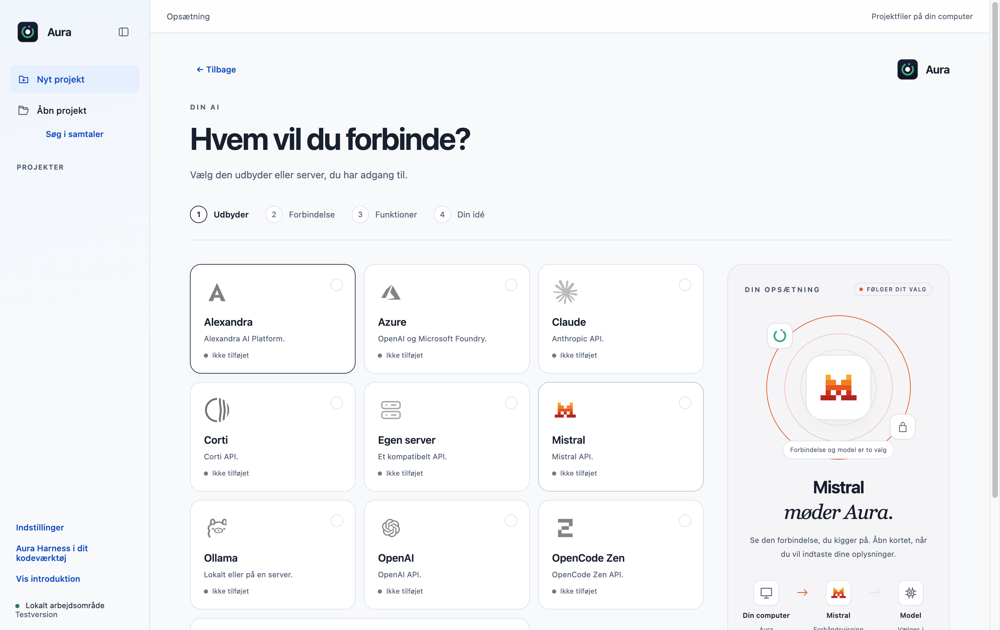
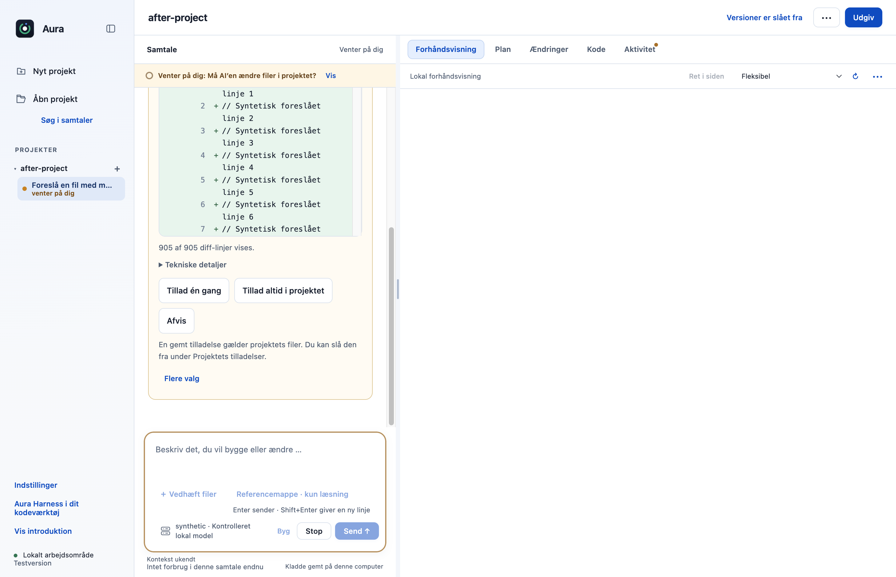
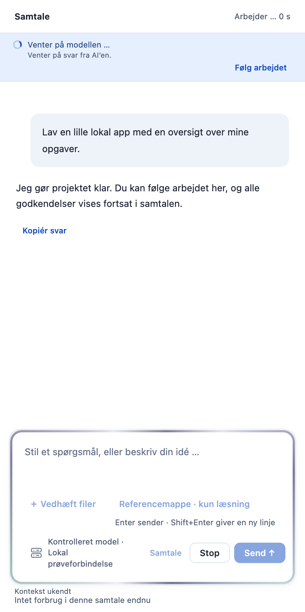

# Samlet integration af 24 PR’er i Parthees fork

Dato: 24. oktober 2026. Mål: `Parthee-Vijaya/ai-harness`, branch `main`.

De 24 bidrag er samlet med særskilte merge-commits og derefter prøvet sammen. Fletningen beholder de præcise feature-commits; bidragenes branches ændres eller slettes ikke. PR’erne til `ai-alliancen-org/ai-harness` skal fortsat stå åbne til originalens egen gennemgang. Integrationstilpasningerne ligger kun i denne fork.

## Rækkefølge

F20 og F03 kombineres uden at fjerne onboarding B. R01/R02 kommer før vedhæftninger og kontekstbinding. F13 er grundlag for F14 og F16; R06 kommer før F08. F05 kommer før F06. F09, F16 og T04 kommer før F15. De øvrige selvstændige bidrag følger deres PR-rækkefølge.

| Orden | PR i fork | Originalens åbne PR | Uændret feature-head |
|---|---|---|---|
| 1 | [F20: visuel AI-opsætning og modelvalg med onboarding B](https://github.com/Parthee-Vijaya/ai-harness/pull/1) | [#17](https://github.com/ai-alliancen-org/ai-harness/pull/17) | `66020ae65dbc` |
| 2 | [F28: Vis aktivt arbejde med en lyskant rundt om chatfeltet](https://github.com/Parthee-Vijaya/ai-harness/pull/2) | [#18](https://github.com/ai-alliancen-org/ai-harness/pull/18) | `1e9ff8ddf329` |
| 3 | [R01: Lad kun den aktuelle opgave modtage svar på AI-spørgsmål](https://github.com/Parthee-Vijaya/ai-harness/pull/3) | [#19](https://github.com/ai-alliancen-org/ai-harness/pull/19) | `539a84913a30` |
| 4 | [R02: Bevar modelsessionen fra Planlæg til Byg](https://github.com/Parthee-Vijaya/ai-harness/pull/4) | [#20](https://github.com/ai-alliancen-org/ai-harness/pull/20) | `9534dc8742a4` |
| 5 | [F07: Vis seneste målte kontekst adskilt fra samtalens forbrug](https://github.com/Parthee-Vijaya/ai-harness/pull/5) | [#21](https://github.com/ai-alliancen-org/ai-harness/pull/21) | `14d7b9aba4ff` |
| 6 | [F03: Vis lokale udbyderlogoer ved den valgte chatmodel](https://github.com/Parthee-Vijaya/ai-harness/pull/6) | [#22](https://github.com/ai-alliancen-org/ai-harness/pull/22) | `03945fccfb37` |
| 7 | [feat: add a reviewed app design skill to the shared library](https://github.com/Parthee-Vijaya/ai-harness/pull/7) | [#23](https://github.com/ai-alliancen-org/ai-harness/pull/23) | `a92c2f6e3736` |
| 8 | [R04: Bevar senere brugerændringer i flettede projektkopier](https://github.com/Parthee-Vijaya/ai-harness/pull/8) | [#24](https://github.com/ai-alliancen-org/ai-harness/pull/24) | `c64e6a022bb9` |
| 9 | [R03: Giv lokale Vite- og Astro-forhåndsvisninger hver sin port](https://github.com/Parthee-Vijaya/ai-harness/pull/9) | [#25](https://github.com/ai-alliancen-org/ai-harness/pull/25) | `2bcc2cf5f66f` |
| 10 | [R06: Vis de faktiske fælles grundregler før afsendelse](https://github.com/Parthee-Vijaya/ai-harness/pull/10) | [#26](https://github.com/ai-alliancen-org/ai-harness/pull/26) | `ed4273fac423` |
| 11 | [F10: Gør AI-svar læsbare med tabeller, kopiering og sikre links](https://github.com/Parthee-Vijaya/ai-harness/pull/11) | [#27](https://github.com/ai-alliancen-org/ai-harness/pull/27) | `61266eb4f08f` |
| 12 | [F11: Søg lokalt i samtalernes beskeder og åbn det præcise træf](https://github.com/Parthee-Vijaya/ai-harness/pull/12) | [#28](https://github.com/ai-alliancen-org/ai-harness/pull/28) | `810293f139ff` |
| 13 | [Vedhæft gennemgåede tekstfiler direkte i samtalen (F13)](https://github.com/Parthee-Vijaya/ai-harness/pull/13) | [#29](https://github.com/ai-alliancen-org/ai-harness/pull/29) | `735ee0716d35` |
| 14 | [Brug udvalgte filer fra referencemapper som læsekontekst (F14)](https://github.com/Parthee-Vijaya/ai-harness/pull/14) | [#30](https://github.com/ai-alliancen-org/ai-harness/pull/30) | `f7806ba99707` |
| 15 | [Stop ejede OpenCode-processer efter brat app-lukning (R05)](https://github.com/Parthee-Vijaya/ai-harness/pull/15) | [#31](https://github.com/ai-alliancen-org/ai-harness/pull/31) | `a9cebb46522d` |
| 16 | [Indtast AI-nøgler i et separat isoleret vindue (F05)](https://github.com/Parthee-Vijaya/ai-harness/pull/16) | [#32](https://github.com/ai-alliancen-org/ai-harness/pull/32) | `d0c40f76c6f0` |
| 17 | [Indtast GitHub-token i det isolerede nøglevindue (F06)](https://github.com/Parthee-Vijaya/ai-harness/pull/17) | [#33](https://github.com/ai-alliancen-org/ai-harness/pull/33) | `9d159942985c` |
| 18 | [Indlæs tidligere gemte beskeder med en diskret knap (F12)](https://github.com/Parthee-Vijaya/ai-harness/pull/18) | [#34](https://github.com/ai-alliancen-org/ai-harness/pull/34) | `818df9700210` |
| 19 | [F31: Gennemgå alle diff-linjer før en filændring godkendes](https://github.com/Parthee-Vijaya/ai-harness/pull/19) | [#35](https://github.com/ai-alliancen-org/ai-harness/pull/35) | `1e8e83325a78` |
| 20 | [F08: Bind gennemgået appkontekst til den konkrete afsendelse](https://github.com/Parthee-Vijaya/ai-harness/pull/20) | [#36](https://github.com/ai-alliancen-org/ai-harness/pull/36) | `0bcfd04eb21a` |
| 21 | [F09: Skeln modelkatalogets oplysninger fra observeret værktøjsstøtte](https://github.com/Parthee-Vijaya/ai-harness/pull/21) | [#37](https://github.com/ai-alliancen-org/ai-harness/pull/37) | `8fa0fc53ba08` |
| 22 | [F16: Vedhæft gennemgåede PNG- og JPEG-billeder i chatten](https://github.com/Parthee-Vijaya/ai-harness/pull/22) | [#38](https://github.com/ai-alliancen-org/ai-harness/pull/38) | `048c361f2f47` |
| 23 | [T04: Verificér pakkens kildeidentitet og samtlige runtime-filer](https://github.com/Parthee-Vijaya/ai-harness/pull/23) | [#39](https://github.com/ai-alliancen-org/ai-harness/pull/39) | `9e605a593791` |
| 24 | [F15: Gennemgå lokalt udtrukket PDF-tekst før deling i chatten](https://github.com/Parthee-Vijaya/ai-harness/pull/24) | [#40](https://github.com/ai-alliancen-org/ai-harness/pull/40) | `7ee4f71e3645` |

## Samspillet mellem bidragene

- Onboarding B beholder store kort, brandfarver og højre visualisering. Modellogoer og glow fungerer sammen med de nye nøglefelter og vedhæftninger. Ingen ny visuel retning er indført under integrationen.
- Sessionens identitet er adskilt fra en konkret vedhæftningsgodkendelse. En engangsgodkendelse kan ikke genbruges, mens en fortsættelse kan beholde samme modelsession og plan.
- F08’s kontrol af appkontekst og F13/F14/F16/F15’s kontrol af gennemgået materiale udføres begge før afsendelse og igen efter motorens opstart. Ændret materiale eller forbindelse kræver en ny gennemgang.
- Stop under en asynkron filkontrol forhindrer, at motoren bagefter starter opgaven. Spørgsmål fra tidligere kørsler giver fortsat ingen rettigheder til en ny opgave.
- Historiksøgning og indlæsning af tidligere beskeder deler beskedidentiteter og undgår dobbelte beskeder. Kladde, plan og arbejdsmåde bevares.
- En opstartshændelse kunne oprette en tom samtalevisning, før den gemte plan blev indlæst. Det er rettet og regressionstestet: den aktuelle plan vises efter genstart, mens en allerede indlæst visning beholder sin nyere plan.
- Pakkens filregler omfatter både procesvogteren, PDF-worker og de nødvendige PDF-afhængigheder. Runtimeversionerne er bevaret.

## Verifikation af den samlede kode

Miljø: macOS Apple Silicon, Node 22.23.3, Electron 44.4.4 og OpenCode 1.18.33. Alle projekter, konti og nøgler i de native prøver er syntetiske. Modelkald går til kontrollerede lokale servere; OpenCode-motoren og Electron-appen er reelle.

| Prøve | Resultat |
|---|---|
| Samtlige desktop-enheds- og integrationstests | 696 bestået; 0 fejlede; 0 sprunget over |
| Samtlige CLI-tests | 27 bestået; 0 fejlede; 0 sprunget over |
| Onboarding B | 7 kontrolgrupper; 21 screenshots; bl.a. udbyderkort, sikre nøglefelter, forbindelsesfejl og smal visning |
| Plan → spørgsmål → rettet plan → godkendt bygning → Stop → genstart | 11 kontrolgrupper; brief og aktuel plan gendannes; 980 × 720 uden vandret sidescroll |
| F08 og F09 | Gennemgåede appfragmenter målt i det faktiske lokale modelkald; udført læseværktøj registreres som observation |
| F13/F14/F16/F15 | Gennemgået mappeudvalg, normaliseret PNG og udtrukket PDF-tekst afprøvet gennem appen; ændrede kilder afvises |
| F31 | Alle 905 diff-linjer kan læses; ingen fil findes før godkendelse; præcis fil skrives efter Tillad én gang |
| F11 og F12 | 80 beskeder indlæses i sider á 20; søgning i ældre beskeder bevarer plan og kladde uden dubletter eller modelkald |
| F05 og F06 | Isolerede sikre nøglefelter; krypteret lagring af syntetiske nøgler; omgåelse af nøglekvittering afvises; Annuller bevarer tilstanden |
| F28 glow | 14 kontrolgrupper; aktiv samtale, ventende godkendelse, Stop, fejl, tastatur, reduceret bevægelse og 720 px bredde |

De automatiske tests omfatter også kopier/fletning, projektregler, særskilte previewporte, procesoprydning, pakkekildeidentitet og runtime-integritet. Det er ikke et bevis på en ny færdig distributionspakke.

Kør desktoptests fra repoets rod med `node --test --test-concurrency=1 desktop/tests/*.test.cjs` og CLI-tests med `node --test --test-concurrency=1 cli/tests/*.test.cjs`. Brug den låste Nodeversion. De native scripts `desktop/scripts/verify-onboarding-b.cjs`, `desktop/scripts/verify-planning.cjs` og `desktop/scripts/verify-composer-glow.cjs` er opdateret/afprøvet på den samlede kode. De øvrige native rapporter og præcise feature-heads findes i [resultaterne](fork-integration-24/results.json).

## Visuel kontrol af den samlede app

Faktiske screenshots fra de isolerede native prøver. Syntetiske prøveprojekter og simulerede modelsvar.

### Onboarding B

### Hele ændringen før godkendelse

### Glow og vedhæftninger i samme samtale

## Afgrænsning

GitHub Actions er ikke startet; projektet kræver særskilt aftale om manuelle workflowkørsler. Ingen produktionsudbyder eller rigtig GitHub-konto er brugt i de nye appprøver, og Windows, Linux samt Intel-Mac er ikke fysisk afprøvet. Der er ikke bygget eller udgivet en ny DMG. F08 kontrollerer appens egne tekstfragmenter og er fortsat ikke fuld Privacy Gate.

Testenes midlertidige profiler ryddes op efter kontrol af, at processerne er afsluttet. Kildekode, beskrivelser, screenshots og eksisterende brugerdata bevares.
