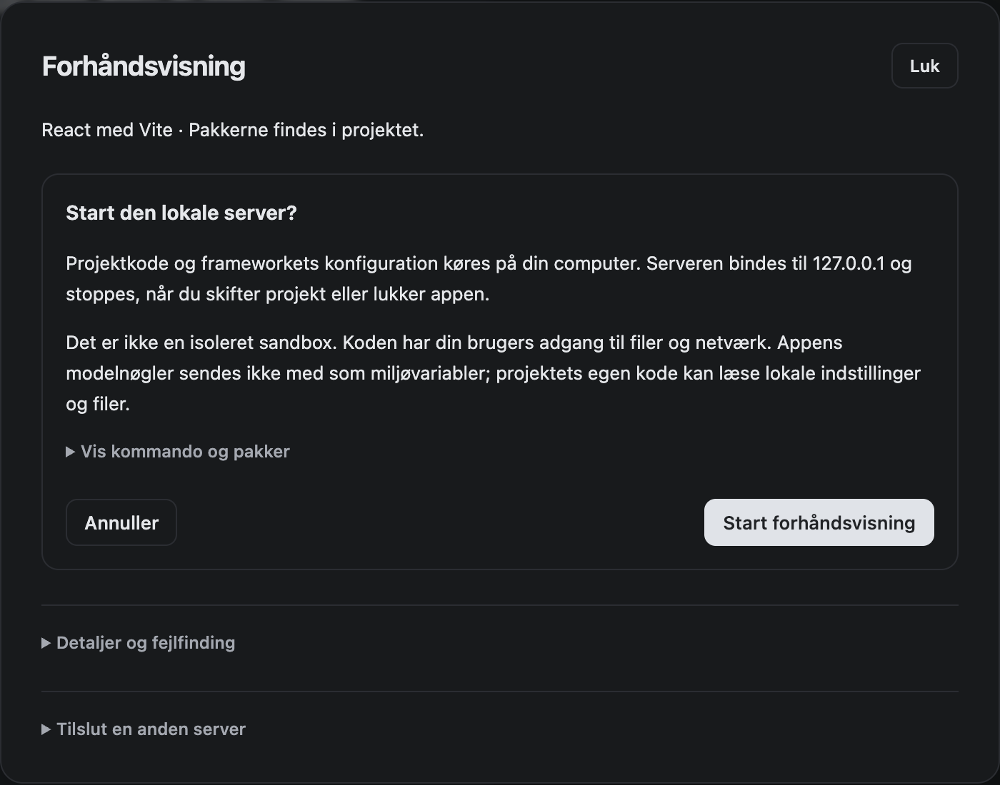
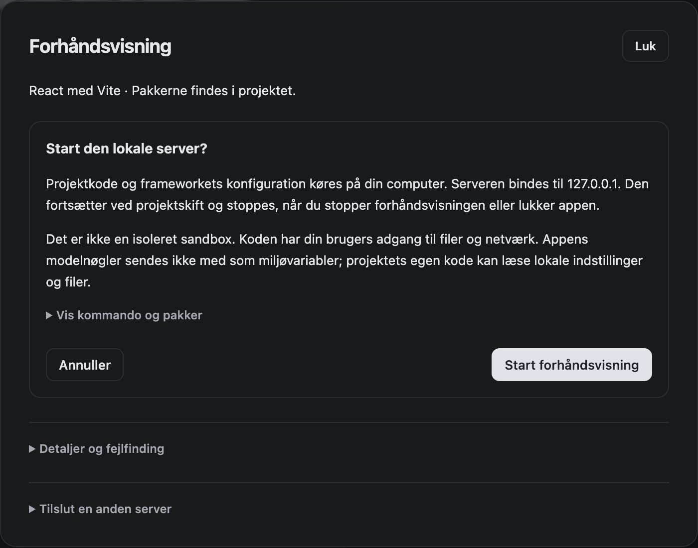

# Pakkeprøve og godkendt servertekst

Den udgivne **Aura 1 beta 0.5.0** (`0.5.0-beta.4`) har nu gennemført den valgte native pakkeprøve efter brugerens nøgleringsgodkendelse. Pakken, tagget og opdateringsfeedet ændres ikke. Den eneste produktændring efter udgivelsen er den særskilt godkendte tekst i serverdialogen; den kommer først med i en senere pakke.

## Den godkendte rettelse

Tidligere sagde dialogen, at serveren stoppede ved projektskift. Appen bevarer allerede separate projekters servere. Teksten siger nu, at serveren fortsætter ved projektskift og stopper ved **Stop forhåndsvisning** eller applukning. Advarslen om lokal kode, fil-/netværksadgang og den udtrykkelige startknap er uændret.

| Før: udgivet pakke | Efter: godkendt kildemodul |
|---|---|
|  |  |

Billederne kommer fra den faktiske pakkede app. Efterbilledet indlæser den ændrede `server.js` i appens renderer mod den uændrede backend; filen er kontrolleret til kun at afvige med den godkendte tekst. Dette er en isoleret dialogprøve, ikke en ny DMG eller en fuld start af kildeappen. En separat start af kildeappen ventede i macOS-nøgleringen og blev stoppet. Der blev ikke ændret i nøgleringen eller startet en projektserver i tekstprøven.

## Beståede forløb i den udgivne pakke

| Forløb | Resultat og omfang |
|---|---|
| Kilde-/runtimekontrol | Pakkens produktfiler matcher udgivelsens kode før tekstrettelsen. |
| Pakkeopstart | Faktisk ASAR, separat profil, begrænset PATH og medfølgende værktøjer. |
| Introduktion og onboarding | 11 kontroller, herunder kladde, projektoprettelse og fravalg uden modelsendelse. |
| Plan, byg, ret og fortryd | 9 kontroller med rigtige filer og OpenCode; kontrollerede modelsvar. |
| Fejl og gendannelse | Forkert nøgle, kvote, afbrudt strøm, Stop, ny plan, genstart, gendan/fortryd og fejlrapport. |
| React/Vite og Astro | 15 kontroller med rigtig installation, HMR, mobilvisning, projektskift og Stop/lukning. |
| Privacy Gate-indstillinger | 6 kontroller, bevaret kladde og gemte valg. |
| Konkret datadeling | Annuller/lokal giver ingen cloudafsendelse; godkend sender præcis de gennemgåede bytes; ændret modtager afvises. Lokal overdragelse har adskilt historik. |
| Feedbackvisning | 20 kontroller af skrivefelt, aktivitet, glow, sidebar, spørgsmål og plan. |
| Arbejdsformer og resultatkort | 18 kontroller, herunder YOLO, konkret fortryd og bevaret godkendelsesadfærd. |

Derudover består **28/28** målrettede tests af pakkestartens identitetskontrol, servergodkendelser og serverejerskab. De tidligere **2.051/2.051** samlede kildeprøver og **20/20** native coreprøver er udgivelsens eksisterende beviser og er ikke kørt på ny for denne tekstændring. [Maskinelt samlet resultat med logfingeraftryk](../releases/beta-0.5.0-evidence/native-ui-final.json).

## Hvorfor to prøvescripts blev rettet

Frameworkprøven ventede på en skjult opstartsknap ved tilbagevenden til et allerede kørende preview. Den kræver nu direkte samme URL og det rigtige indhold; kontrollerne af serverens levetid er bevaret.

Fejlprøvens kontrollerede modelserver kendte ikke OpenCode 2's sammenfatningsformat. Den svarer nu på det dokumenterede format uden at øge modellens kontekstvindue eller slå komprimering fra. Den endelige prøve observerede **19 fysiske modelkald: 8 opgavekald, 7 sammenfatninger og 4 native planpåmindelser**. Hele rækkefølgen, de to præcise sammenfatningsprotokoller, modelvalget og unikke forespørgselsfingeraftryk kontrolleres. Hver brugerbesked forekommer én gang. En planpåmindelse accepteres kun efter det færdige svar med uændret opgavekontekst; den er ikke et genafsendt kald.

De ekstra planpåmindelser er et åbent optimeringspunkt: de giver ekstra modelarbejde efter komprimering. De skjules ikke i optællingen. Tidligere fejlede prøver og deres materiale bevares.

## Grænser og oprydning

Prøverne bruger kontrollerede lokale modelsvar og separate testprofiler på denne Apple Silicon-Mac. De dokumenterer ikke kvaliteten af en betalt models svar, en ren maskine, automatisk opdateringsinstallation eller andre platforme. Den tidligere sporadiske motoropstartsfejl er fortsat uafklaret. Tre høje afhængighedsmarkeringer består; appen er ad hoc-signeret og ikke Apple-notariseret. GitHub Actions er ikke startet.

Kun ejede, afsluttede testprocesser er stoppet i denne opfølgning. Installeret app, brugerprofiler, lokal kode, prøvescripts, rapporter og de udgivne filer er bevaret. Releaseoprydningen på cirka 1,78 GB fra den foregående kørsel er ikke gentaget. Originalprojektet og dets PR'er er uændrede.
