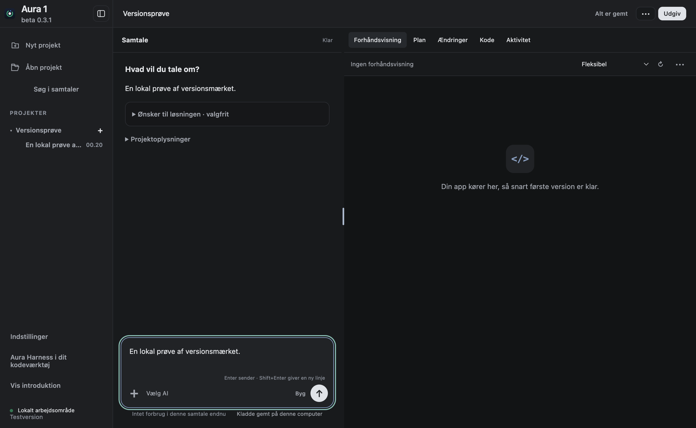
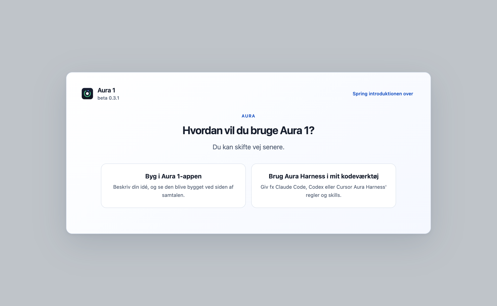
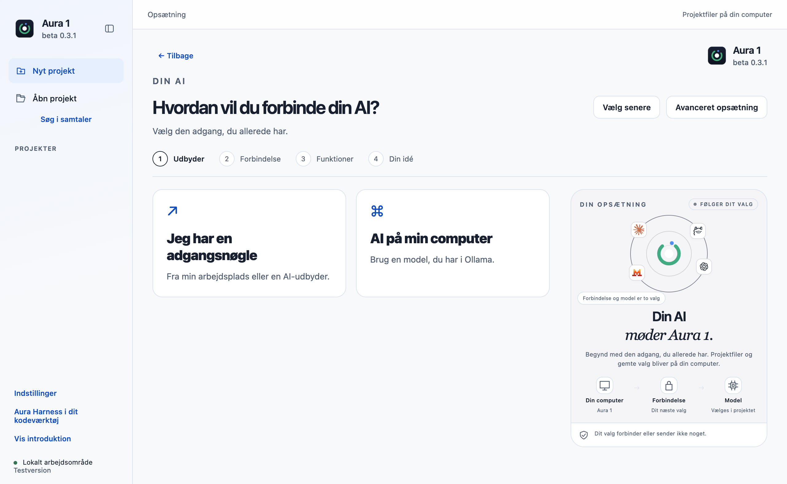

# Aura 1 beta 0.3.1

Ny versionsrække for `Parthee-Vijaya/ai-harness`, 25. oktober 2026. Teknisk appversion: `0.3.1-beta.1`. Målplatform: macOS på Apple Silicon.

## Synlig version og bevarede funktioner

Versionsnummeret står nu tydeligt under Aura 1-navnet ved logoet i sidepanelet, introduktionen og AI-opsætningen. Det læses fra den kørende apps metadata og følger automatisk med i kommende pakker. I et sammenklappet sidepanel viser logoets hjælpetekst det fulde navn og versionsnummer.

Onboarding B, den godkendte arbejdsvisning, alle funktioner, planer og godkendelser er bevaret. Rettelsen af fejlen ved første klik på **Opret projekt** fra beta 1.1 er inkluderet.

Fremover vælges versionsnummeret efter ændringens størrelse: små rettelser giver eksempelvis 0.3.2, større funktioner 0.4.0 og gennemgribende ændringer 1.0.0. Se [den vedligeholdte regel](POLICY.md).

## Installation ved skift til den nye versionsrække

[Hent Aura 1 beta 0.3.1](https://github.com/Parthee-Vijaya/ai-harness/releases/tag/v0.3.1-beta.1).

Luk Aura 1, åbn DMG’en, og erstat appen i Programmer. Bevar alle projekt- og datamapper. **Denne overgang fra beta 1/1.1 kræver manuel installation**, fordi det tekniske versionsnummer går fra 1.x tilbage til 0.3.1. Beskyttelsen mod automatisk nedgradering er bevaret. Senere opdateringer kan følge den nye stigende versionsrække.

App-, profil- og nøgleringsidentiteter er uændrede. Den kørende app på brugerens computer er ikke erstattet under pakningen.

## Afprøvning

Pakket kildecommit: `89a162512eae06daabea8c74350b554b7a612c93`. Efterfølgende commits i tagget vedrører dokumentation og opdateringsmetadata.

- **748 desktoptests og 27 CLI-tests** består.
- **6 native kontroller** af versionsmærket består i den faktiske app fra DMG’en: match med native metadata, onboarding B, mørkt/lyst arbejdsområde uden afskæring, sammenklappet logo og ingen rendererfejl.
- **15 native kontroller af projektoprettelse** består i samme DMG, med rigtig Git. Rettelsen af første klik, blokering af parallelle oprettelser, bevarede kladder, genforsøg og uændrede godkendelser er efterprøvet.
- Kildebeviset kontrollerer **213 produkt-/profilfiler** og **5.222 runtimefiler**. OpenCode 1.18.33, Node 22.23.3 og Git 2.53.0 følger fortsat med.
- Appsignatur, DMG-checksum og ZIP-indhold består. Opdateringsreglerne afviser automatisk nedgradering og accepterer stigende versioner i den nye række.

Se [native versionsprøve](beta-0.3.1-evidence/version-native.json), [projektoprettelse](beta-0.3.1-evidence/project-create.json), [opdateringsregel](beta-0.3.1-evidence/version-policy-check.json), [kildebevis](beta-0.3.1-evidence/package-source.json) og [filmanifest](beta-0.3.1-evidence/release-manifest.json).

Dette er lokal afprøvning på denne Mac; GitHub CI, Intel-Mac, Windows, en anden fysisk computer og ny afprøvning af eksterne AI-modeller indgår ikke. Appen er ad hoc-signeret og **ikke notariseret**. De øvrige [kendte begrænsninger fra beta 1](aura-1-beta-1.md#kendte-begrænsninger), herunder afhængighedsfund, gælder fortsat.

## Releases og oprydning

Forkens tidligere releases, beta 1 og beta 1.1, erstattes af denne nye begyndelse. Deres [beskrivelser og metadata](retired/) er arkiveret. Git-tags, historik, lokal kildekode, worktrees og brugerdata bevares. Originalprojektets releases og PR’er er ikke omfattet.

Ubrugte installationspakker og verificerede testbuilds ryddes op efter udgivelsen. **Lokal kode slettes ikke, heller ikke efter commit og push.** Rapporterne og beskrivelserne bevares. Release-assets er begrænset til DMG, opdaterings-ZIP og SHA256SUMS.txt.

## Billeder fra den færdige DMG

