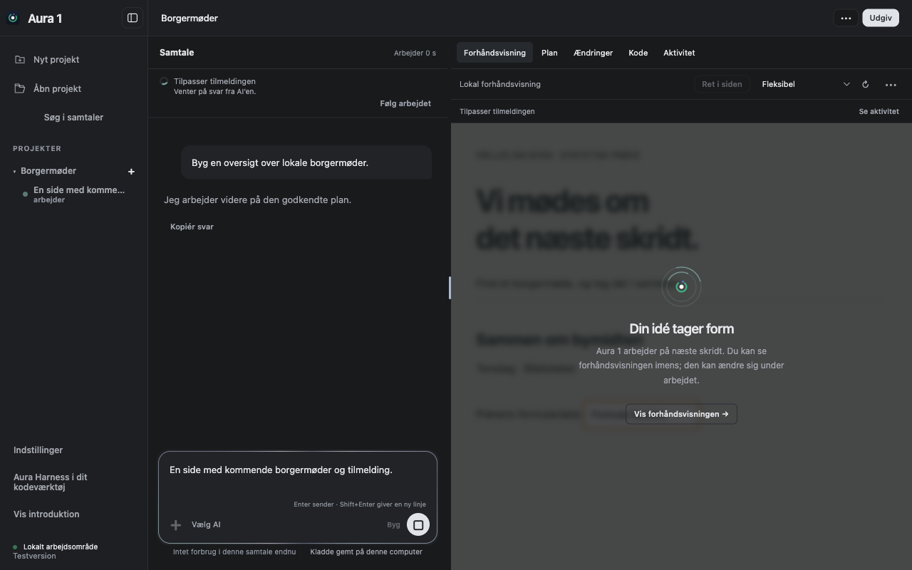
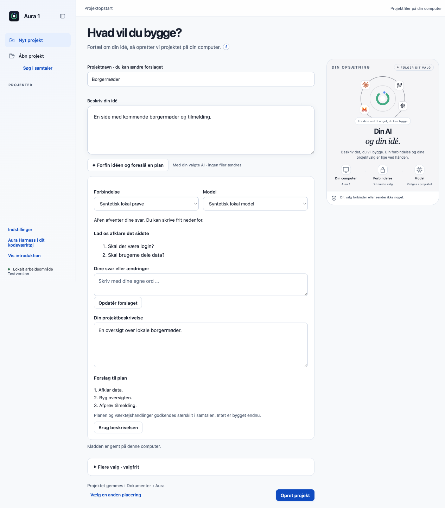
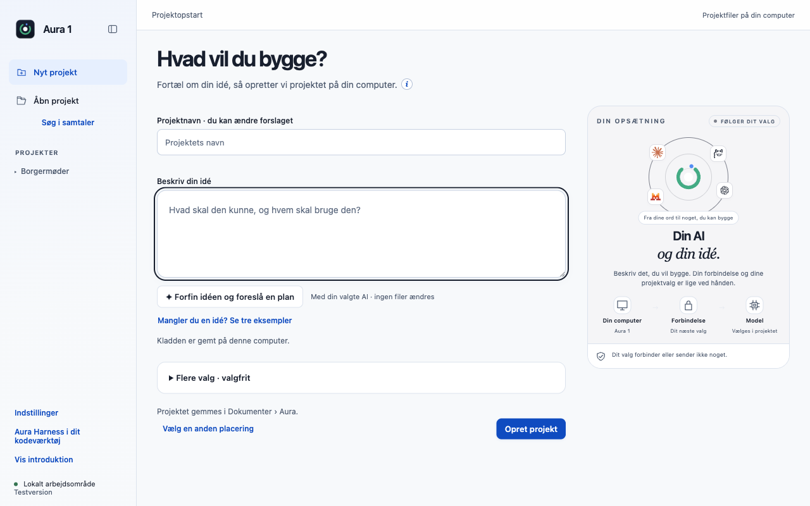
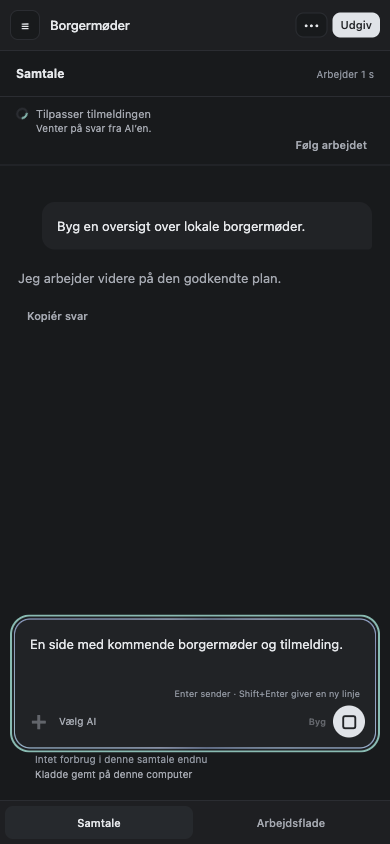

# Aura 1 beta 1

Første navngivne udgivelse af den samlede `Parthee-Vijaya/ai-harness`-fork. Appversion: `1.0.0-beta.1`. Målplatform: macOS på Apple Silicon. Originalens åbne PR’er bliver ikke flettet ved denne udgivelse.

## Indhold

De 24 tidligere sammenlagte bidrag er bevaret sammen med de ti opdateringer og syv nye bidrag:

| Område | Beskrivelse og prøvegrundlag |
|---|---|
| Forbindelsen | [Afgrænsede genforsøg før svar](../contributions/model-retries/README.md) |
| Samtalens tilstand | [Genoptagelse med session og kontekst](../contributions/session-recovery/README.md) |
| Designskill | [Hovedskill til byggeopgaver](../contributions/primary-design/README.md) |
| Før projektoprettelse | [Idéhjælp og planudkast](../contributions/idea-refinement/README.md) |
| Godkendelser | [Fuld tilladelse til den aktuelle samtale](../contributions/conversation-permission/README.md) |
| Arbejdsområde | [Godkendt mørk visning og kompakt chat](../contributions/calm-workspace/README.md) |
| Forhåndsvisning | [Synlig arbejdsstatus og Vis alligevel](../contributions/preview-working/README.md) |

Onboarding B, planlægning, eksplicitte godkendelser og de eksisterende forbindelser er bevaret. Produktnavnet er Aura 1; datafolderen, projektfolderen og den eksisterende nøgleringsidentitet skifter ikke navn. En separat `--user-data-dir` bevares særskilt. Denne fork er ikke det separate Code-OSS-baserede Aura-1-repository.

## Installation og opdatering

Hent DMG’en fra [forkens release](https://github.com/Parthee-Vijaya/ai-harness/releases/tag/v1.0.0-beta.1), åbn den og kopiér **Aura 1.app** til den ønskede placering. Bevar den eksisterende app, indtil du har afprøvet denne udgave i en separat profil. Appen er ad hoc-signeret til lokal betatest, **ikke Developer ID-signeret eller notariseret**. macOS kan derfor kræve manuel åbning/godkendelse i systemets sikkerhedsindstillinger.

ZIP-filen er appens opdateringspakke; DMG’en er til manuel installation. SHA256SUMS.txt gør det muligt at kontrollere begge filer. Appens opdateringsfeed er bundet til denne forks repository, version, platform og filnavn. Den henter eller installerer ikke automatisk en ny version uden valg.

## Afprøvning

Pakken er bygget fra commit `ffbeada7b40d12ab4e266211819eb784f9a24ef4`. Senere ændringer i udgivelsens tag omfatter kun dokumentation og opdateringsmetadata.

- 748 desktoptests og 27 CLI-tests består på macOS.
- Den faktiske DMG er kontrolleret, monteret skrivebeskyttet og startet i en separat syntetisk profil med begrænset PATH. Projektfiler, medfølgende værktøjer og det rigtige preview virker.
- 212 produkt-/profilfiler er bundet til kildecommitten, og 5.222 runtimefiler er integritetskontrolleret. OpenCode 1.18.33, Node 22.23.3 og Git 2.53.0 følger med.
- Idéhjælp består 7 kontroller, arbejdsvisningen 21 (inklusive 320–1280 pixels) og previewstatus 12 i appen fra DMG’en.
- Tilladelsesprøven kører den rigtige OpenCode-motor: advarsel, efterfølgende tilladte handlinger, beskyttelse af en fil uden for projektet, tilbagekaldelse og nulstilling ved genstart består. Modelserveren er kontrolleret og lokal.
- Hovedskillen er afprøvet gennem seks forløb for Mistral-/Corti-protokoller og CLI, med og uden designfunktionen. Dette kontrollerer transporten af instruktioner, ikke ekstern modelkvalitet.
- Hele appbundlens signatur og ZIP-filens komprimerede indhold er kontrolleret. SHA-256 og SHA-512 fremgår af [manifestet](beta1-evidence/release-manifest.json).

Se [pakkens kildebevis](beta1-evidence/package-source.json), [den monterede DMG-prøve](beta1-evidence/dmg-native.json), [tilladelsesprøven](beta1-evidence/permission.json) og de øvrige [testfiler](beta1-evidence/). Kontrollerede modelservere anvendes til reproducerbare fejl- og godkendelsesforløb; dette er ikke en kvalitetsmåling af Mistral, Corti eller andre eksterne modeller. GitHub CI og en anden fysisk testcomputer er ikke en del af denne lokale beta-kvalifikation.

## Oprydning og fremtidige udgivelser

Efter verificeret udgivelse fjernes denne opgaves midlertidige pakkefiler og syntetiske testprofiler. Kilder, beskrivelser, brugerdata og worktrees med aktive PR’er bevares. Kun de tre nyeste færdige lokale DMG-versioner skal beholdes. Navnet på en release skal være kort; funktionsbeskrivelser hører til i beskrivelsen.

## Kendte begrænsninger

- GitHub CI er ikke kørt som release-gate. Resultaterne ovenfor er lokale. Intel-Mac, Windows, installation på en anden computer og opgradering fra en tidligere app er ikke nativeafprøvet her.
- Appen er ad hoc-signeret og ikke notariseret. Den lokale signeringsprofil tillader indlæsning af Electrons biblioteker uden et fælles Developer ID. Det er ikke en produktionssignering.
- [Afhængighedstjekket](beta1-evidence/audit-production.json) rapporterer seks pakker med høj alvorlighed, inklusive nedarvede fund fra `node-forge`, `toml` og `zod`. En særskilt vurdering af udnytteligheden i Aura er ikke udført. En automatisk foreslået nedgradering af OpenCode-pluginet er ikke anvendt. Betaen skal derfor ikke behandles som sikkerhedsgodkendt til følsomme data.
- En statusbesked efter overførsel af idéudkastet har lav kontrast i mørkt tema. Den godkendte brugerflade er bevaret; en visuel rettelse afventer særskilt godkendelse.

## Billeder fra denne DMG

Billederne er taget i den pakkede Aura 1 med syntetiske projekter. Arbejdsstatus er kontrolleret fremkaldt og er ikke en live-demonstration af en ekstern model.

