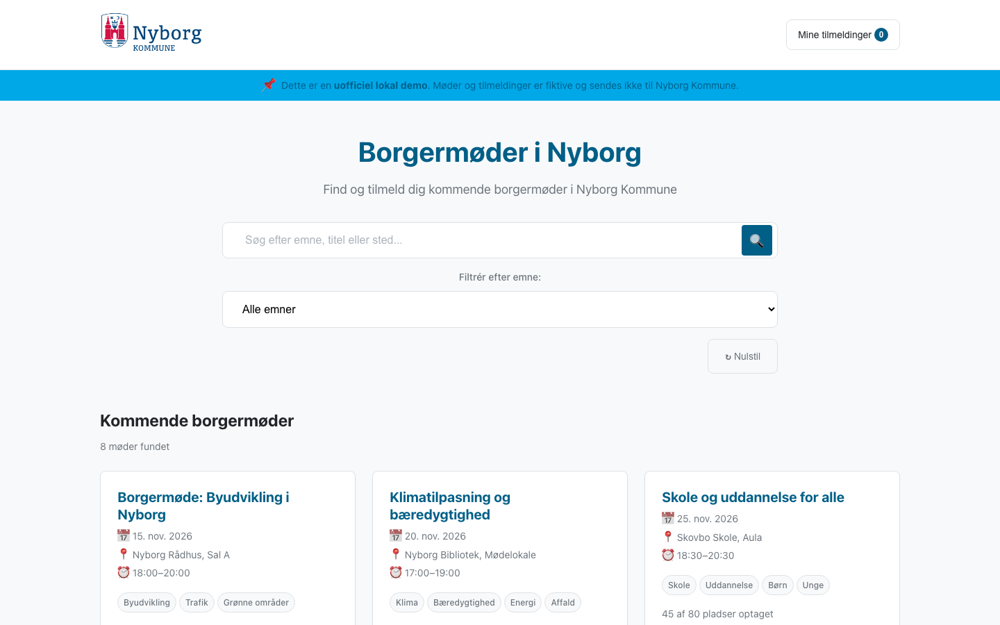
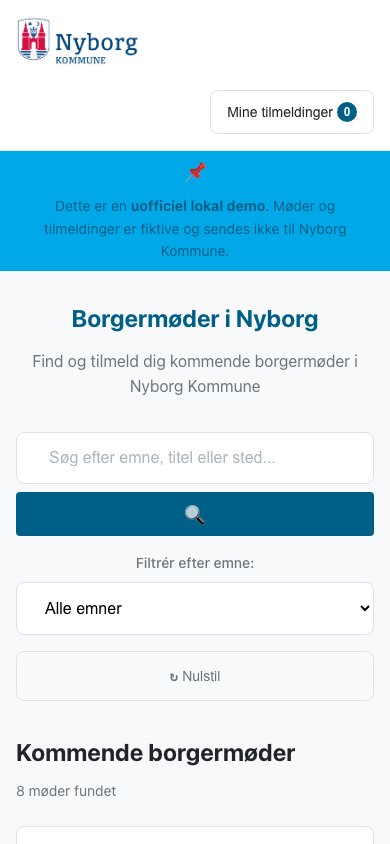
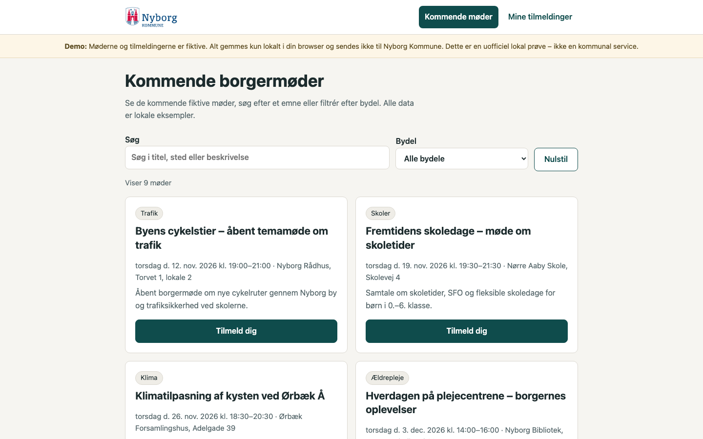
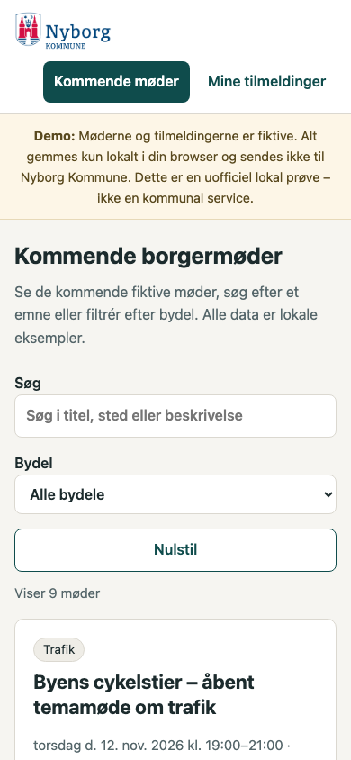
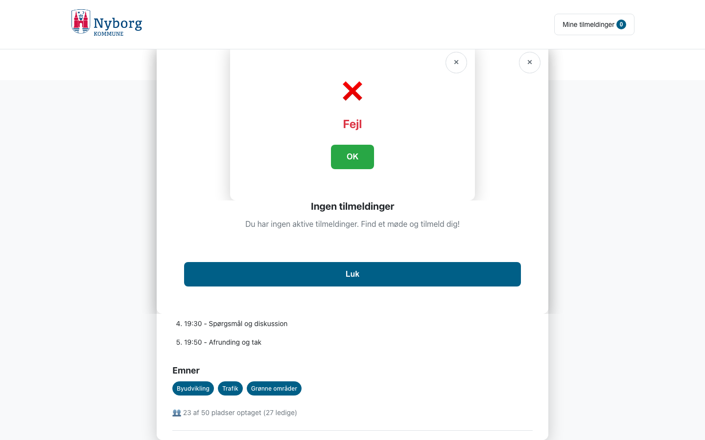
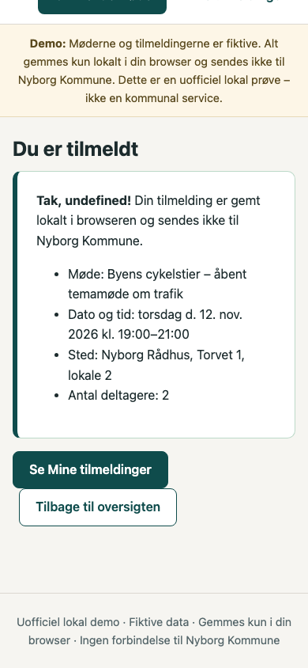

# Kommunal designprøve med Mistral og Corti

25. oktober 2026. Rigtige AI-kald gennem Auras native Workbench, gateway og OpenCode. Indholdet er fiktive borgermøder og en lokal prøvetilmelding. Ingen modelgenererede filer er håndrettet.

## Resultat

Den fælles kildepakke virker som hjælp: begge modeller læste referencefilen før bygning og brugte Nyborg Kommunes originale logo korrekt. Design og funktionalitet blev fortsat forskellige. Ingen af de to resultater er klar som færdig borgervendt løsning.

| | Mistral Medium 3.5 | Corti S1 |
|---|---|---|
| Model-id | `mistral-medium-3-5` | `corti-s1` |
| Indsats | Udbyderens standard | Low |
| Tid, inkl. plan og kontrol | 254 sek. | 142 sek. |
| Modelkald, hele forløbet | 17 | 27 |
| Anslået pris, hele forløbet | 1,496 USD | 0,593 USD |
| Generering | Udkast gemt; reparationsforløb afvist | Forløb afsluttet |
| Browserprøve | 24 bestået / 2 fejlet | 14 bestået / 12 fejlet |
| Originale kildefiler | Uændrede | Uændrede |
| Første → sidste udkast | Samme filer | Samme filer |

Browserantallene er 13 konkrete kontrolpunkter afprøvet ved både 1440×900 og 390×844. De er ikke en designkarakter eller en fuld tilgængelighedscertificering. Pris er Auras estimat fra rapporteret forbrug, ikke en faktura.

## Hvad brugeren faktisk møder

**Mistral:** Liste, søgning, filter, detaljer, validering, tilmelding, bekræftelse, genindlæsning og afmelding fungerede i browserprøven. Navn og antal blev gemt. En alvorlig dialogfejl bliver dog tilbage: CSS-reglen `.modal { display: flex }` gør lukkede dialoger synlige i dokumentet. Escape fjerner `open`, men dialogen forbliver synlig. Det gælder allerede ved indlæsning og blev verificeret særskilt ved begge størrelser.

Den automatiske kontrol fandt også 38 kontrastfund og et semantikfund. Antallet er kontrollens kandidater og omfatter indhold uden for første skærmbillede; det er ikke 38 særskilte certificerede fejl. En konkret, synlig kontrastfejl er bekræftet: demo-banneret bruger tekst `#005F87` på `#00A8E8`, cirka 2,60:1 ved 14 px. Reparationsforløbet blev stoppet, da pilotens tilladelsesbedømmelse afviste to `grep`-kald mod projektets `public/styles.css`. Den præcise afvisningsgren er ikke bevaret. Det er en begrænsning i evalueringen, og vi kan derfor ikke bedømme modellens evne til at rette fundene. Modeltekstens påstand om, at alle kontroller bestod, blev ikke accepteret som testbevis.

**Corti:** Prøven viser en sammenhængende, rolig opbygning, men centrale funktioner fejler. Søgning tilføjer ét resultat til de oprindelige ni kort i stedet for at erstatte listen. Filteret tilføjer to kort og viser elleve, selv om tælleren siger to. Der er ingen direkte vej fra mødekortet til detaljesiden; brugeren må først gå til tilmelding og derefter tilbage til mødet. Navnet gemmes ikke, så bekræftelse og historik viser `undefined`. Afmelding lukkes uden at fjerne registreringen. Tom søgning, feltvalidering, genkendelse af allerede tilmeldt møde og Escape i afmeldingsdialogen fungerede.

Begge appudkast gav nul JavaScript-fejl og forsøgte ingen eksterne browserkald. Det viser samtidig, at nul konsolfejl og grøn teknisk kontrol ikke er nok til at godkende et brugerforløb. Cortis automatiske kontrol fandt ingen fejl, men den efterfølgende konkrete brugerprøve fandt ovenstående mangler.

## Visuel vurdering af de uredigerede skærmbilleder

Mistral har et tydeligt hierarki, en konsekvent blå palette og ordnede mødekort. Den lange, centrerede søgeblok bruger meget plads; første mødekort begynder først nederst på mobilskærmen. Emojiikoner, det stærke cyan-banner og den lange dialog med tilmelding langt nede giver et mere generisk og mindre gennemarbejdet udtryk end målbilledet.

Corti har mere kompakte sider, afdæmpede flader, ensartede kontroller og forståelig tekst. Det ser roligere ud, men er stadig en enkel kortbaseret prototype uden særlig visuel identitet eller illustration. Mobilens to handlingsknapper står tæt på hinanden efter bekræftelse. De faktiske flowfejl vejer tungere end det rolige første indtryk.

Begge har et reelt logo og en brugbar struktur. Ingen af dem dokumenterer, at et enkelt skill kan garantere et poleret førsteudkast uafhængigt af model. Denne prøve viser forskelle i ét forløb pr. model; den kan ikke fastslå en generel rangorden.

## Officielle kilder og egne designvalg

[Nyborg Kommunes logoside](https://www.nyborg.dk/da/om-kommunen/logo/) var den verificerede primære kilde. Tre originale PNG-filer med navnetræk blev lagt uændret i begge projekter. Begge valgte farvevarianten, viste den på hvid baggrund og bevarede proportionerne uden filter eller omfarvning. SHA-256, billedformat og dimensioner blev kontrolleret. Der er ikke lavet et nyt kommunevåben.

En offentlig, fuld manual med officielle UI-farver og webfonte blev ikke fundet i de gennemgåede kilder. Mistrals blå UI og Cortis mørke turkis/creme er derfor modellernes egne designforslag. Vi har ikke verificeret dem som kommunens designguide. Den private, lokale prøve er tydeligt mærket uofficiel og indeholder ingen rigtig kommunal bestilling eller tilmelding. Den er ikke kommunalt godkendt. Logobrug ved en senere offentlig eller kommerciel lancering skal vurderes særskilt.

Begge modeller har fundet på adresser, afdelinger og møder som eksempelindhold. Disse oplysninger er ikke faktatjekkede og må ikke genbruges som kommunale fakta. Corti inkluderer eksempelvis Nørre Aaby som bydel; kildepakken indeholdt ingen bydelsliste. Demomarkeringen er derfor vigtig.

Supplerende kilder: [tilgængelighed på Nyborg.dk](https://www.nyborg.dk/da/om-hjemmesiden/tilgaengelighed/) og [kommunens beskrivelse af sit webdesign](https://www.nyborg.dk/da/nyheder/nyt-design-og-forbedret-soegefunktion-gaa-paa-opdagelse-paa-den-nye-hjemmeside/). De bruges ikke som bevis for en fuld grafisk manual.

## Ens prøvegrundlag og afgrænsning

- Samme danske opgave, 11 aktive skills, 11 startfiler og originale logoer. Hashene er ens i `input-provenance.json`.
- Begge læste `public/brand-reference.json` i planfasen før første filændring.
- Samme effektive grænser: 200.000 konteksttokens, 16.384 outputtokens, højst 64 modelkald og 900 sekunder pr. tur. Providerformat og indsatstilstand kan stadig variere.
- Normal plan blev fremlagt og godkendt før bygning. Hver konkret filændring fik engangstilladelse i prøveprojektets `public/`. Ingen YOLO, vedvarende tilladelser, shell, Git eller eksterne værktøjskald.
- Kildepakken var uforanderlig under prøven. Ingen overførsel af eksisterende brugerprojekter, brugerdata eller hemmeligheder til modellerne.
- 135 produkt- og skillfiler var byte-identiske før og efter modelkørslerne.
- Browserne kørte på samme Chromium 153.0.8010.12 med rene, separate kontekster. Prøvetilmeldingen brugte navnet “Prøveperson” og to deltagere. Appstatus blev kun ændret gennem synlige kontroller, ikke gennem indsprøjtet lokal lagring.
- Cortis første filterprøve brugte en for præcis label-selector. Hele browserprøven er kørt igen med den verificerede `select#area`; den reelle fejl er 11 kort i stedet for 2. Den første prøves timeout tælles ikke som produktfejl.
- Ingen GPT-version af borgermødeopgaven er kørt. GPT-forbindelsens særskilte transportproblem er ikke et designresultat og skal ikke sammenlignes som en tom app.

## Hvad Aura med fordel kan hjælpe med

Aura kan samle og verificere officielle kildefiler, markere hvad der er ukendt og stille samme dokumenterede materiale til rådighed for modellen. Modellen skal fortsat forme designet gennem de aktiverede skills. Førsteudkastets kvalitet skal bedømmes visuelt og gennem opgavens faktiske brugerforløb.

Næste tekniske opfølgning er at gøre evaluatorens afvisning af sikre, konkrete `grep`-kald forklarlig og supplere kontrolgrundlaget med registreringsforløbet og lukkede dialoger. En ny reparationstest skal i givet fald køres som en ny, tydeligt mærket runde. Denne runde og alle kilder bevares.

## Første udkast og fejlbeviser

Billederne er originale captures fra samme Chromium og samme skærmstørrelser. Der er ingen håndpolering. Første og sidste udkast har identiske kildehashes for begge modeller.

| Model | Desktop | Mobil |
|---|---|---|
| Mistral |  |  |
| Corti |  |  |

Mistrals dialoger mangler `open`, men vises stadig. Capturen nedenfor er taget efter Escape og rulning til dialogområdet:

Corti siger “Viser 1 møde”, men browseren indeholder ti mødekort, herunder et uvedkommende skolekort:

Cortis bekræftelse viser det manglende navn direkte:

## Dokumentation og adgang

- [Sanitiserede resultater og kildehashes (JSON)](evidence/brand-models-20261025/results.json).
- [Alle konkrete browserkontroller (CSV)](evidence/brand-models-20261025/checks.csv).
- [Klikbar intern sammenligning med desktop/mobil og flere visninger](https://mac-studio-tilhrende-parthee.tailefb5b1.ts.net/aura-ui/brand-model-test-20261025/). Kræver adgang til det private netværk; billederne ovenfor kan læses direkte i repositoryet.

De komplette lokale prøveprojekter, originale snapshots, kildepakker og rapporter er bevaret. Repositoryet indeholder kun denne gennemgåede rapport, JSON/CSV og syv screenshots. Ingen auth-data, rå requests, forbindelseskonfiguration, sessionslogs, private lokale stier eller genereret projektkode er medtaget. PNG-filerne indeholder ingen tekst-/EXIF-metadata og er kopieret byte-identisk.

Ingen produktændring, commit, push eller DMG er foretaget som del af denne delopgave. Prøven ændrer ikke onboarding B, UI, funktioner, planer eller godkendelsesregler.
