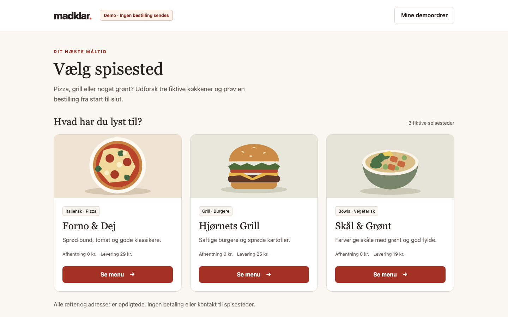
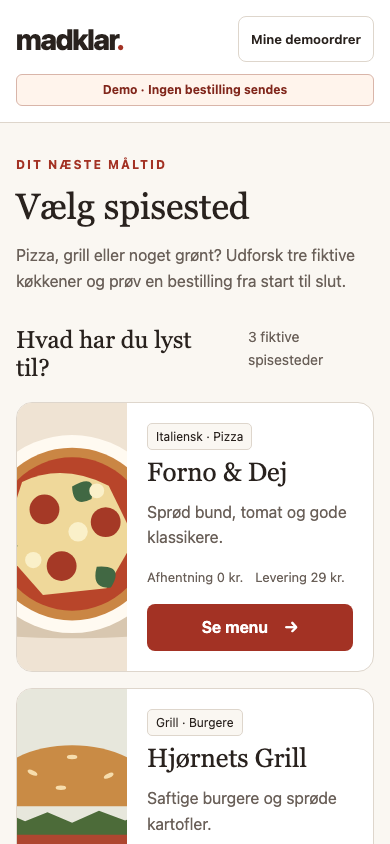
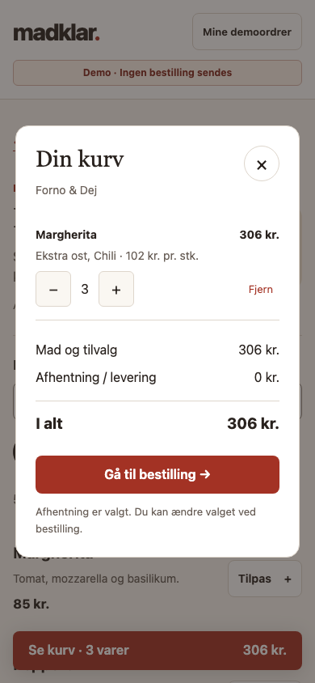
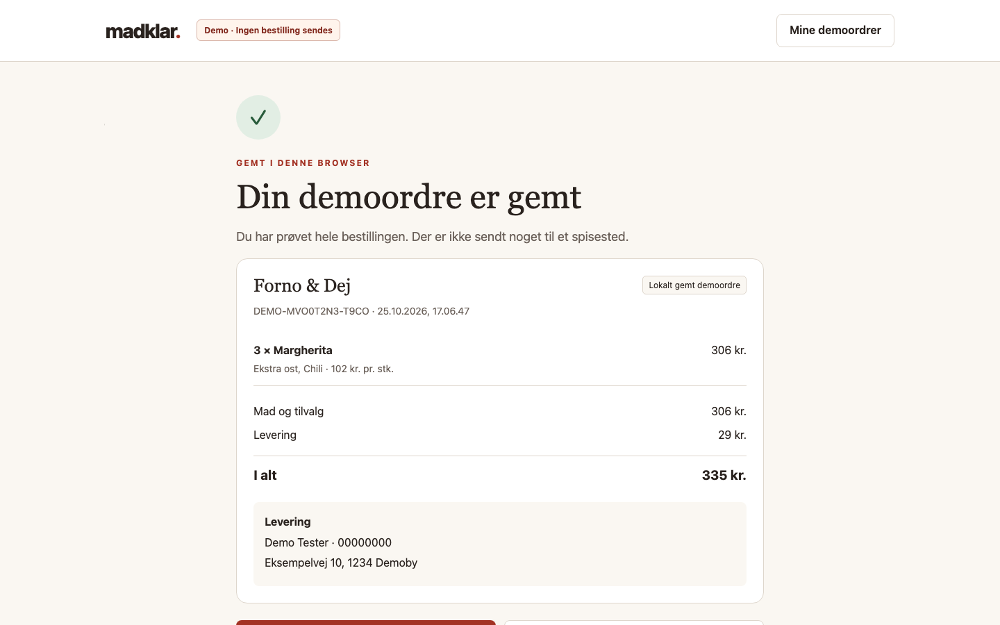
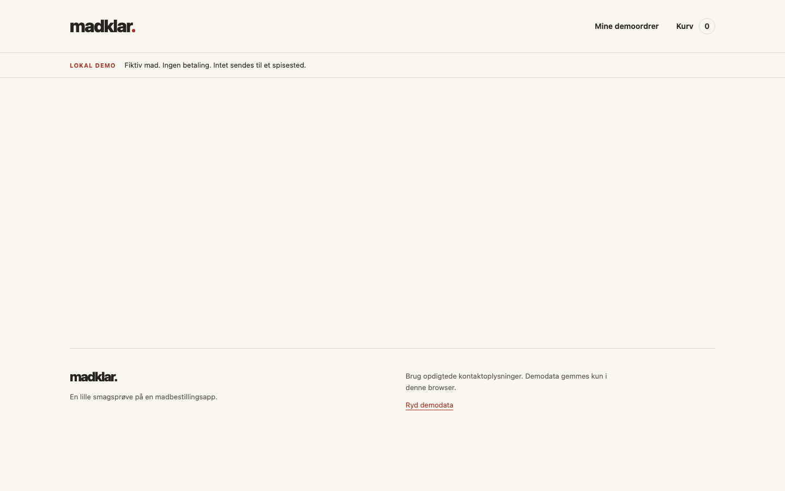

# GPT-transportprøver — 25. oktober 2026

**GPT-stabiliteten er fortsat ikke løst.** Den endelige adapter med typede argumenter frembragte en app, der består **26 browserkontroller på desktop og mobil**. Men selve Aura-kørslen blev afbrudt ved sin samlede 900-sekundersfrist efter to modeltimeouts, inden Auras automatiske kvalitetskontrol. Et fungerende kodeoutput er derfor ikke det samme som et bestået samlet agentforløb.

Den eksperimentelle Codex CLI-bro er kun til evaluering. Den er ikke en ny produktforbindelse og indgår ikke som automatisk reserve i Aura.

## Seneste prøve: typede argumenter

Præcis `gpt-6.1-sol` med low fik samme madapp-opgave, projektnavn `Madklar` og skillfiler som den umiddelbart forudgående transportprøve. En hashkontrol af hele skillmanifestet blev gennemført før første modelkald. Opgavens SHA-256 er `2f2521346ec12ccb28ae0742316e70faf582c1a714d892eb455aee431033c48d`.

Aura brugte sin rigtige Workbench, bevaret samtale, OpenCode og konkrete godkendelser. Evaluatoren godkendte planen med dens hash og senere præcis to filændringer i `public/`: HTML/CSS/tre SVG-filer samt `app.js`. Ingen shell, Git, netværksværktøjer eller filer uden for det tilladte projektområde blev godkendt. Codex' egne værktøjer var deaktiveret. Der er ingen håndrettelser af den genererede app.

| Del | Faktisk resultat |
|---|---|
| Plan | Bestod på 54,7 sekunder |
| Første byggekald | Skills og opgaveliste, 10,3 sekunder |
| Næste to inferenser | Hver afbrudt efter 300 sekunder; kun `thread.started` og `turn.started`, ingen modeltekst eller værktøjsresultater |
| Auras sidste normale genforsøg | Gyldig HTML/CSS/SVG-patch efter 100 sekunder |
| JavaScript | Gyldig patch efter 133,9 sekunder |
| Samlet byggeforløb | Stoppet ved 900,1 sekunder under det sidste afslutningskald |
| Auras kvalitetskontrol | Nåede ikke at starte |
| Efterfølgende browserprøve | 26/26 kontroller bestod, kilder uændrede |

Genforsøgene før filændringer brugte identiske requests. Hver faktisk patch blev udført én gang efter sin konkrete godkendelse. Den afsluttende proces blev lukket, da Auras klient stoppede. Der blev ikke lagt en ekstra modelkørsel eller manuel rettelse ovenpå resultatet.

De to timeoutlogs indeholder ingen fejltekst eller færdige tokens. De kan derfor **ikke afgøre**, om tiden gik til kø, inferens eller en intern transportventetid. Den nye prøve dokumenterer, at typede argumenter undgår de tidligere escape-fejl for disse patches; den dokumenterer ikke, at ventetiden er løst.

## Det faktiske appresultat

Chromium 153 afprøvede den urørte app ved 1440 × 900 og 390 × 844. Begge størrelser gennemførte:

- Spisestedsvalg, menusøgning og nulstilling.
- Pizza med ost og chili, antal og beregning af kurv.
- Levering med korrekt gebyr og afhentning uden gebyr.
- Ugyldige kontaktoplysninger, læsbare fejl og efterfølgende korrekt bestilling.
- Bekræftelse, historik og kurv efter genindlæsning.
- Escape i dialog og eksplicit bekræftelse før skift til et andet spisested tømmer kurven.

Der var ingen registrerede runtime- eller consolefejl, eksterne requests eller vandret overflow. Kildernes hashes var uændrede før og efter. Ti screenshots er gemt; de viser kun modelgenereret kode med syntetiske demodata.

De øvrige billeder viser [desktopmenu](evidence/gpt-typed-20261025/desktop-menu.png), [desktopkurv](evidence/gpt-typed-20261025/desktop-cart.png), [desktopbestilling](evidence/gpt-typed-20261025/desktop-checkout.png), [mobilmenu](evidence/gpt-typed-20261025/mobile-menu.png), [mobilbestilling](evidence/gpt-typed-20261025/mobile-checkout.png) og [mobilbekræftelse](evidence/gpt-typed-20261025/mobile-confirmation.png).

Visuelt er resultatet sammenhængende med varme farver, tydeligt typografisk hierarki og egne SVG-illustrationer. En synlig kant i oplevelsen er, at feltfejl bliver stående, mens brugeren retter værdierne, og først forsvinder ved næste afsendelse. Det blokerede ikke de afprøvede bestillinger. Billederne bør bruges til konkret vurdering, ikke som en påstand om perfekt design eller fuld tilgængelighed.

## Forbrug og sammenlignelighed

Den seneste prøve tog samlet 955,1 sekunder. 11 requests blev startet; otte gav færdige, validerede svar. Bekræftet forbrug for disse otte er **405.043 inputtokens og 15.580 outputtokens**, heraf 52.480 cachede inputtokens. Forbruget fra de tre afbrudte kald er ukendt og må ikke tælles som nul. Prisen gennem Codex-adgangen er ukendt.

Opgave og skills er de samme som i den oprindelige modelsammenligning. Dens projektnavn var dog `Madbestillingsdemo`, og Codex-broen har en ekstra transportinstruktion. Dette er derfor en særskilt transportprøve, ikke en byte-identisk ny sammenligning med Mistral og Corti. Fra den første transportprøve til denne blev `app-quality.cjs` rettet separat for en kontrast-fejlregistrering; modulet blev slet ikke aktiveret i denne prøve. De øvrige tre registrerede produktmoduler og alle skills var ens. Alle registrerede produktkilder forblev uændrede under selve modelkørslen.

Den direkte OpenRouter-rute var tidligere afvist med 402. Ingen betaling, grænse, credentials eller model blev ændret. Testbroen genbruger den eksisterende Codex-adgang og dokumenterer ikke en direkte OpenAI API-rute. Den oplyste fælles outputgrænse i Aura er heller ikke bevis for en tilsvarende hård begrænsning i Codex CLI.

## Tidligere forsøg: kompakt argumentstreng forkastet

Den oprindelige runde var stoppet efter en 600-sekunders Codex-timeout uden færdigt svar. En hypotese var det store strikte værktøjsschema. En kompakt variant reducerede schemaet fra 6.310 til 405 bytes ved at lade argumenterne være en JSON-streng. Det gav **ikke** en stabil løsning:

- Planen tog 66,5 sekunder, og det første byggekald tog 279 sekunder trods kun 233 outputtokens.
- Næste kald skrev HTML, CSS og tre SVG-filer gennem Auras godkendelse.
- Tre efterfølgende `app.js`-patches havde ugyldig indre JSON omkring JavaScript-anførselstegn. Alle blev afvist før udførelse.
- Byggefasen sluttede som fejl efter 793,6 sekunder. Der var ingen approval- eller hydreringslås; næste request indeholdt det faktiske resultat fra den allerede udførte patch.

Den kompakte variant er forkastet og bevaret privat som fejlbevis. Den endelige adapter bruger typede argumentobjekter, validerer dem mod Auras originale schemas og serialiserer én gang ved overdragelsen til OpenCode. **15 lokale adaptertests består**, herunder JavaScript-anførselstegn, optional/null-felter, stop, timeout, proceslukning og afviste svar med registreret forbrug.

Den tidligere delvise app havde intet `app.js` og et tomt hovedområde. Den blev heller ikke håndrettet:

Det tidligere forsøg afsluttede ni inferenser, hvoraf seks svar kunne overdrages, mens tre blev afvist. Alle ni inklusive de afviste brugte 457.654 inputtokens og 34.268 outputtokens. Hele forsøget tog 860,8 sekunder.

## Konklusion og oprydning

Typed-transporten har nu live evidens for gyldige kildekodepatches, og den genererede app fungerer i de beskrevne browserprøver. **Det samlede stabile GPT-forløb er stadig ikke bestået:** tidsgrænsen afbrød afslutningen, og Auras egen kvalitetskontrol mangler. Timeoutårsagen kræver bedre signal fra modeltransporten eller en fungerende direkte API-rute; at hæve fristen alene er ikke en dokumenteret rettelse.

Alle egne AI-, Workbench/OpenCode-, browser- og previewprocesser er lukket. Lokal kode, testprofiler og rå evidens er bevaret. Aura-produktets UI, modelvalg, onboarding, planer og godkendelser er ikke ændret af transportarbejdet. Intet er committet, pushet eller udgivet af denne prøve.
