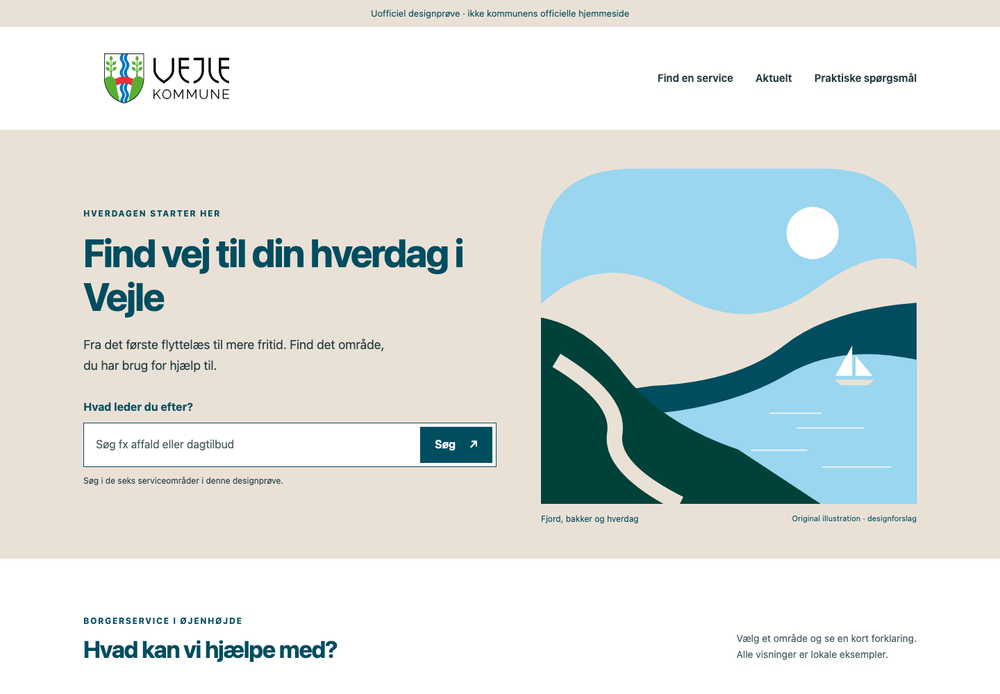
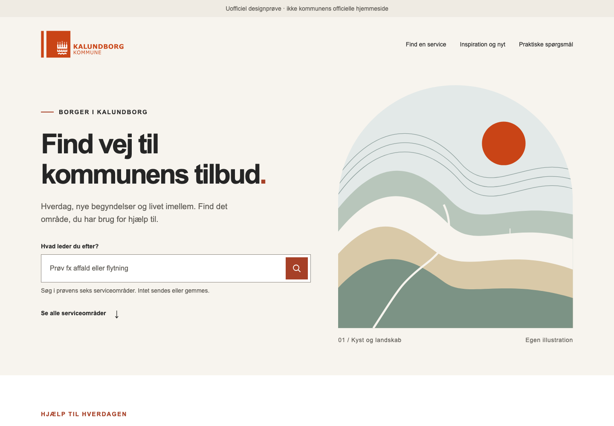
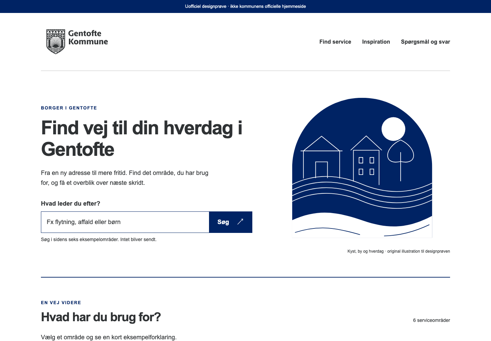
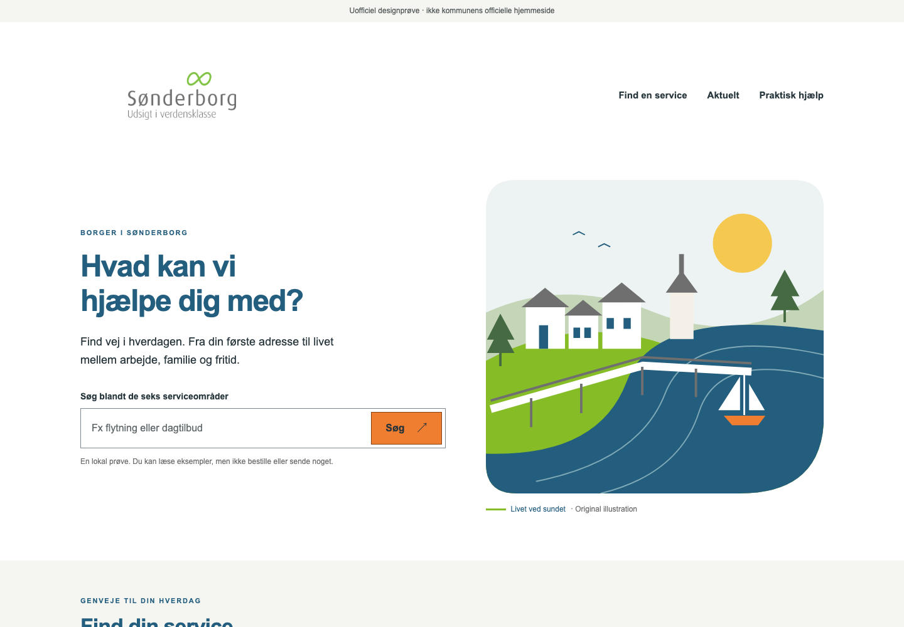
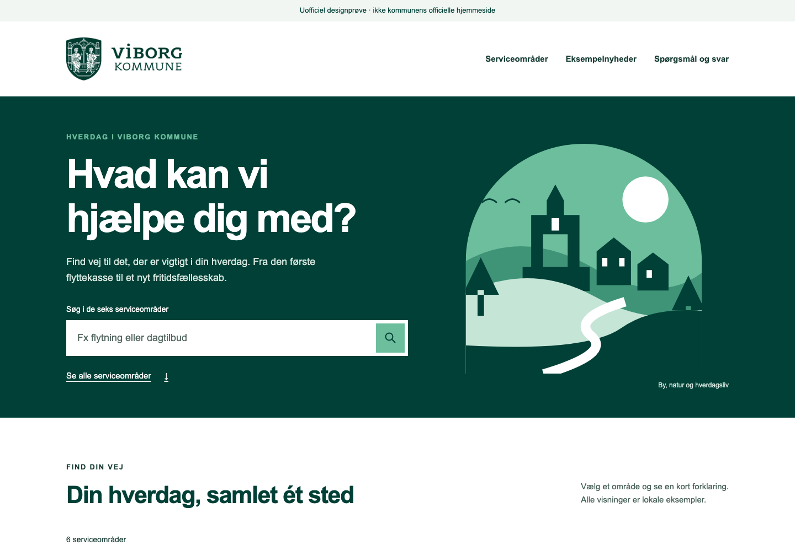
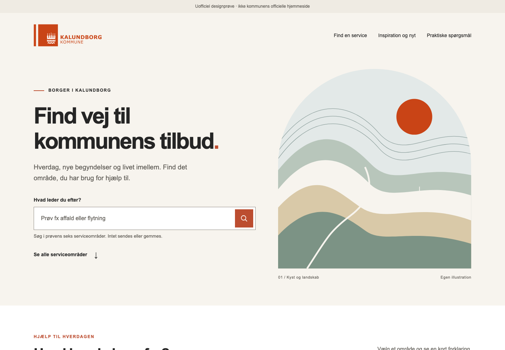
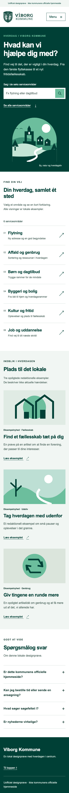

# Fem kommunale designprøver med GPT-6.1 Sol

Den afsluttende prøverunde gennemførte fem rigtige Aura-forløb med **GPT-6.1 Sol, low**: Plan → konkret plangodkendelse → Byg → Auras kvalitetskontrol → uafhængig browser- og billedkontrol. De fem sider bestod samlet **331/331 browserkontroller og 60/60 visuelle kontroller**. Det er uofficielle designprøver med lokale eksempelhandlinger, ikke kommunernes officielle hjemmesider.

Denne dokumentation gør resultaterne og deres begrænsninger reviewbare uden at offentliggøre prompts, samtaler, loginoplysninger, forbindelsesdata eller rå modellogs. [JSON-resultater](evidence/municipal-landings-20261025/results.json), [CSV-resultater](evidence/municipal-landings-20261025/results.csv) og [billedmanifest med SHA-256](evidence/municipal-landings-20261025/manifest.json) følger med.

## Metode og afgrænsning

Alle fem opgaver brugte samme grundopgave og aktive Aura-designskills; kommunens navn og forberedte brandkilder varierede. Den valgte model udformede siderne. Der blev ikke påtvunget en fælles sideskabelon, og den genererede kode blev ikke rettet manuelt. De eksisterende projektregler, konkrete filgodkendelser og plangodkendelser blev bevaret.

Kørslerne brugte Auras kildekode og den lokale evalueringsbro til Codex. Det er **ikke en test af den installerede app, en ny DMG eller en direkte OpenAI API-provider**. Billederne viser apps, som Aura har genereret, ikke en ændring af Auras eget UI eller onboarding B.

Evalueringsbroen holdt Auras eksplicitte kontekst adskilt fra Codex-værtens implicitte skills, plugins og memory. Den efterfølgende ændring i designvejledningen, som tillader relevante tilgængelige GPT-/Claude-designskills sammen med Aura-design, indgik ikke i disse fem kørsler. Resultaterne dokumenterer derfor ikke effekten af den nye vejledning og er heller ikke en sammenligning med Mistral eller Corti.

De fem modelkørsler brugte frosne kilder fra før den efterfølgende reviewrettelse af fokusmåling ved ændret padding/geometri. Den ekstra præcisionsrettelse har sin egen regression og nativeprøve; resultaterne her er ikke omskrevet til at gælde ny kode. PR-beskrivelsen skal skelne mellem de historiske modelkørsler og valideringen af den seneste kode.

## Resultater og bevaret historik

| Kommune | Browser | Visuelt | Automatiske rettelser / QA-rettelser | Kvalitetsadvarsler ved afslutning | Første snapshot og slutkilde ens |
|---|---:|---:|---:|---:|---|
| Vejle | 69/69 | 12/12 | 0 / 0 | 14 | Ja |
| Kalundborg | 62/62 | 12/12 | 1 / 0 | 0 | Nej |
| Gentofte | 69/69 | 12/12 | 0 / 0 | 13 | Ja |
| Sønderborg | 69/69 | 12/12 | 0 / 0 | 14 | Ja |
| Viborg | 62/62 | 12/12 | 0 / 1 | 11 | Nej |

**Fem beståede forløb er resultatet af den afsluttende rettelsesrunde.** De oprindelige 11 forsøg og to tidligere mislykkede rettelsesforsøg er bevaret lokalt, sammen med 1.297 evidensfiler. De er ikke omklassificeret til beståede eller medregnet som succeser i tabellen. Direkte modeludkast fra tidligere sammenligninger tæller ikke som Aura E2E.

De 52 tilbageværende heuristiske advarsler vedrører små tekststørrelser og kontrolsemantik. De er bevaret i JSON-resultaterne, selv om fejlgrænsen og de konkrete browser-/billedkontroller består. Det er ikke en fuld tilgængelighedscertificering eller garanti for perfekt design.

Der blev udført **79 reelle modelkald, uden transporttimeout eller valideringsfejl** i denne runde. Modellen lavede fortsat **26 læseopslag til manglende filstier (ENOENT)**. Broen skjulte eller omskrev dem ikke; modellen fik de faktiske fejlresultater. Alle faser afsluttede inden grundfristen på 900 sekunder uden at bruge tidsreserven.

CLI'en rapporterede 4.732.127 inputtokens og 72.778 outputtokens. Den fulde samtalehistorik blev sendt igen ved efterfølgende kald, så samme kontekst tæller flere gange. Der er ikke beregnet en pris. Prøven isolerer ikke effekten af hver transportrettelse og garanterer ikke fremtidig modelstabilitet.

De første browserprøver indeholdt også forkert formulerede testantagelser om store/små bogstaver, fokus på en bestemt overskrift og native dialogers fokusgrænse. Testene blev rettet ud fra observeret browseradfærd uden appændringer. De oprindelige rapporter er bevaret.

## De fem færdigtestede sider

Desktopbillederne er 1.440 × 1.000, mobilbillederne 390 × 844. De viser de første skærmbilleder af siderne; funktionerne længere nede indgik også i browserkontrollerne. Klik på mobilvisningen for den tilsvarende optagelse. Billederne er kopieret uændret fra den gennemgåede evidens og indeholder ingen PNG-tekstmetadata.

### Vejle

[Mobilvisning](evidence/municipal-landings-20261025/vejle/mobile.png)

### Kalundborg

[Mobilvisning](evidence/municipal-landings-20261025/kalundborg/mobile.png)

### Gentofte

[Mobilvisning](evidence/municipal-landings-20261025/gentofte/mobile.png)

### Sønderborg

[Mobilvisning](evidence/municipal-landings-20261025/sonderborg/mobile.png)

### Viborg

[Mobilvisning](evidence/municipal-landings-20261025/viborg/mobile.png) · [Hele mobilsiden](evidence/municipal-landings-20261025/viborg/mobile-full.png)

## Før og efter: brug billederne korrekt i en PR

“Før” betyder det frosne snapshot før Auras første automatiske kvalitetskontrol i denne runde. Det kan allerede indeholde flere modelhandlinger og er **ikke nødvendigvis modellens første svar**. “Efter” betyder den færdigtestede kilde efter eventuelle produkt- og QA-rettelser. Begge er genererede demoapps. En PR må ikke beskrive disse par som før/efter af Auras værts-UI, en DMG-opdatering eller bevis for et perfekt første udkast.

### Kalundborg: kontrast og læsbarhed

Modellen udførte én automatisk kvalitetsrettelse. Accentfarven blev mørkere fra `#BC4D30` til `#A64027`, og små tekster blev forstørret. Den visuelle retning og logoerne blev bevaret. Der var én kvalitetsfejl og 14 advarsler i første snapshot; ved afslutning var der ingen.

| Før kvalitetskontrol | Efter automatisk rettelse og test |
|---|---|
|  |  |

[Mobil før](evidence/municipal-landings-20261025/kalundborg/first-mobile.png) · [Mobil efter](evidence/municipal-landings-20261025/kalundborg/mobile.png)

### Viborg: tekstfejl i mobiloverskriften

Den uafhængige billedkontrol fandt “Spørgsmålog svar” nederst på mobilsiden. Samme model rettede det til “Spørgsmål og svar” gennem en ny konkret plan og godkendelse i samme samtale og enginesession. Alle 62 funktionelle kontroller bestod allerede før rettelsen; tekstfejlen var et særskilt visuelt fund. Kun den genererede `index.html` blev ændret. De almindelige viewportbilleder viser ikke dette område; derfor vedlægges de fulde mobiloptagelser.

| Før QA-rettelse — se FAQ nederst | Efter QA-rettelse — se FAQ nederst |
|---|---|
|  |  |

Vejle, Gentofte og Sønderborg havde identiske første og afsluttende kilder og vises derfor ikke med kunstige før/efterpar.

## Separat regression: Auras fokusmåling

Den afgrænsede produktrettelse bruger reelt Tab-input i en isoleret browser til at opdage en usynlig fokusramme med samme farve som baggrunden. Den har 34 beståede unit-/livscyklusprøver og 24 native Electron-kontroller. Native regression og grænseprøver består, inklusive Stop, netværksgrænser, dialoger og eksisterende kvalitetsfund. Hele desktopsuiten bestod 843/843 prøver; den samlede kilde-/evidenskontrol bestod 155/155.

Fokusmålingen er en konservativ stikprøve på 12 Tab-trin pr. viewport. Kun identiske opake sRGB-farver på en kendt ensfarvet baggrund udløser fejlfund. Komplekse baggrunde, alternative markeringer og usikre forhold får ikke en automatisk fejldom. Den er ikke en fuldstændig tastatur- eller tilgængelighedstest. Disse tal vedrører de dokumenterede testkørsler den 25. oktober 2026; en senere PR bør angive sine nye testresultater særskilt.

## Validering af den efterfølgende PR-kilde

Efter reviewrettelsen af fokusmåling ved ændret geometri/typografi er den aktuelle kilde testet særskilt: **843/843 desktoptests, 32/32 JavaScript-evalueringstests, 3/3 OpenEnv-adaptertests og 34/34 native fokuscases**. Den oprindelige bevarede Viborg-regression detekteres stadig på både desktop og mobil, uden ændring af appkilden. Nativeprøven foretog ingen udgående netværkskald.

[Verifikation med kilde- og loghashes](evidence/municipal-landings-20261025/pr-source-verification.json) adskiller disse nye resultater fra de historiske modelkørsler ovenfor. De fem dyre modelkørsler er ikke gentaget med den sidste fokusrettelse eller den nye skilltekst. Ingen ny DMG er bygget, og GitHub Actions er ikke kørt som del af denne verifikation.

## Proveniens og offentlig deling

Manifestet angiver SHA-256, dimensioner og evidensrelativ oprindelse for alle 14 billeder samt hashes af de lokale kilderapporter. De rå kilderapporter offentliggøres ikke her. JSON og CSV er håndudvalgte resuméfelter uden private brugerpaths, auth eller rå requestindhold. Kommunelogoerne indgår som materiale i tydeligt markerede uofficielle designprøver; billederne dokumenterer ikke kommunal godkendelse eller en officiel hjemmeside.
